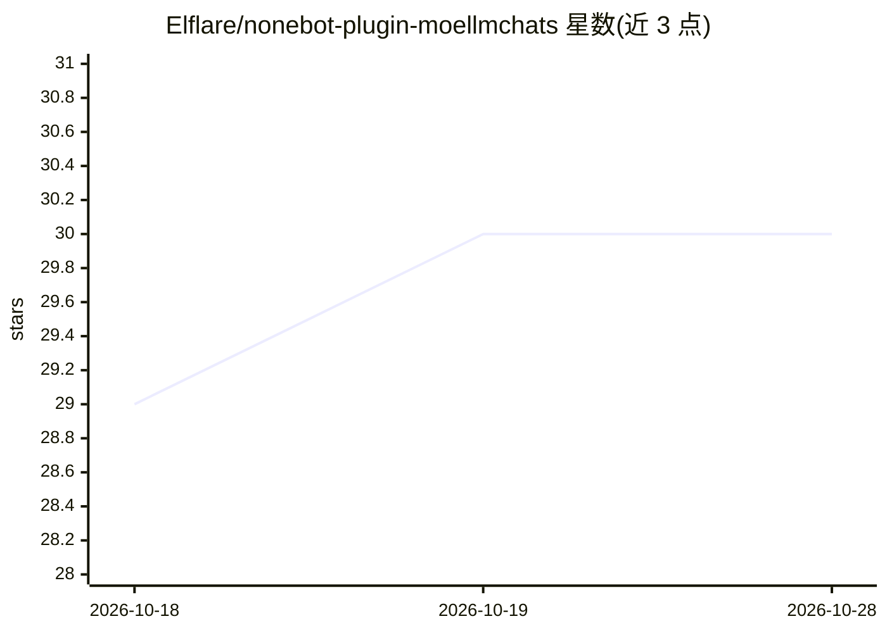

# Elflare/nonebot-plugin-moellmchats

⭐ 30 · Python · GPL-3.0 · 推送 2026-07-17 · [GitHub](https://github.com/Elflare/nonebot-plugin-moellmchats) · 个人维护 · 中文 README

**NoneBot2 的多模型调度 LLM 群聊插件，含联网搜索与工具调用**

基于 NoneBot2 框架的聊天机器人插件，面向 QQ 等 NoneBot 适配平台的群主与机器人开发者。核心机制为 MoE 式混合调度：分类模型按问题难度（简单/中等/复杂）路由至不同模型，支持所有 OpenAI 兼容接口；提供群组/用户双层级上下文存储、语义触发 Tavily 联网搜索、预分类-后注入两阶段工具调用以节省 Token、多模态图片识别（需配置视觉模型如 GPT-4o）、性格预设与分段发送等拟人化设计。通过 nb-cli 或 uv 安装，配置文件首次运行自动生成，提供指令热切换模型与工具。

## 筛选速览

| 维度 | 判定 | 备注 |
|---|---|---|
| AI 角色 | `ai-native` | 本体是模型或模型工具 |
| 许可风险 | `viral` | GPL-3.0 |
| 部署形态 | `library` | 以包/库形式分发 |
| 模型依赖 | — | README 未给出锁定关系 |
| 硬件要求 | — | 无带数字的原话,不猜 |
| 安装摩擦 | `low` | 无编译、无系统依赖或容器化 |
| 成熟度 | — | 结构信号不足 |

## 能力要点

- MoE 混合调度：按难度分级动态路由模型，兼容所有 OpenAI 兼容接口
- 预分类-后注入两阶段 Function Calling，按需注入 Tool Schema
- 群组/用户双层级上下文隔离，用户侧含滑动窗口+TTL 过期
- 多模态视觉：有图片时切换视觉模型，历史自动回退纯文本省 Token

## 适用场景

- 给 QQ 群机器人接入多模型调度对话
- 群聊场景下做带联网搜索与工具调用的 AI 助手
- 多服务商 API 间按任务难度分配模型并统计 Token 消耗

## 场景标签

`聊天机器人` · 领域:对话与助手

## 证据(README 行号)

> L5: ✨ 混合专家模型调度LLM插件 | 混合调度·联网搜索·上下文优化·个性定制·Token节约·更加拟人 ✨
> L13: - **MoE架构（混合专家模型调度）**：动态路由至最优模型，支持所有OpenAI兼容接口；智能难度分级（简单/中等/复杂）自动匹配模型，Token消耗降低35%
> L94: |@Bot或以nickname开头|无|群聊|对话内容|聊天对话|

## 星数曲线

2026-10-18 29 → 2026-10-28 30（+1）

---
*卡片 v1 · prompt 1.4 · 生成 2026-10-26 · 置信度 high · 依据 README sha `c0bf3fbdf60b` · [字段定义](../../DATASET.md)*
