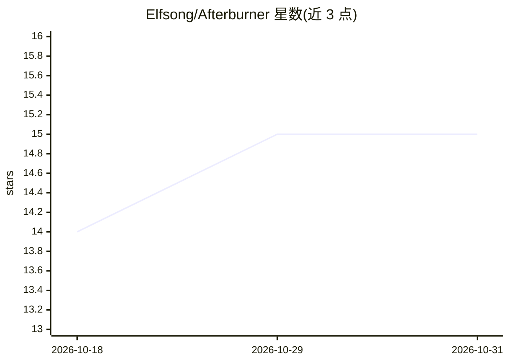

# Elfsong/Afterburner

⭐ 15 · Python · 推送 2026-04-05 · [GitHub](https://github.com/Elfsong/Afterburner) · [官网](https://arxiv.org/abs/2505.23387) · 组织维护

**用 RL 迭代优化 LLM 生成代码运行效率的训练框架与模型**

研究项目 Afterburner：在测试时构建闭环迭代优化框架，让 LLM 基于执行沙箱（Monolith）的实测性能反馈反复精炼代码，以提升生成代码的运行效率。比较 SFT、DPO、GRPO 三种训练策略，GRPO 持续获得效率增益（pass@1 从 47% 到 62%）。提供 Venus 多语言数据集、GRPO/SFT/DPO 训练配方与 3B 模型权重，训练依赖 LLaMA-Factory 与 verl，评测用 Litmus。以论文加代码仓库形式面向科研用户。

## 筛选速览

| 维度 | 判定 | 备注 |
|---|---|---|
| AI 角色 | `ai-ecosystem` | LLM/agent 周边工具 |
| 许可风险 | `none` | — |
| 部署形态 | `None` |  |
| 模型依赖 | — | README 未给出锁定关系 |
| 硬件要求 | — | 无带数字的原话,不猜 |
| 安装摩擦 | `low` | 无编译、无系统依赖或容器化 |
| 成熟度 | — | 结构信号不足 |

## 能力要点

- 闭环迭代优化：LLM 基于执行反馈反复精炼代码效率
- 比较 SFT/DPO/GRPO 三种策略并给出训练配方
- Venus 数据集覆盖 Python3/C++/JavaScript/Go/Rust/Java 六种语言
- Monolith 执行环境支持并行隔离容器与 10kHz 性能测量

## 适用场景

- 训练提升 LLM 生成代码运行效率的模型
- 研究 RL 执行反馈在代码优化中的作用
- 复现论文实验或在其数据集上开展后续研究

## 场景标签

`强化学习` `科研工具` `代码生成` · 领域:编码与开发

## 证据(README 行号)

> L13: To tackle this, we introduce **Afterburner**, an iterative framework that leverages reinforcement learning (RL) to 
> L48: We explore three optimization strategies within IOF. Namely, **Supervised Fine-Tuning (SFT)**, **Direct Preference 

## 星数曲线

2026-10-18 14 → 2026-10-31 15（+1）

---
*卡片 v1 · prompt 1.4 · 生成 2026-10-30 · 置信度 high · 依据 README sha `daf26f34e099` · [字段定义](../../DATASET.md)*
