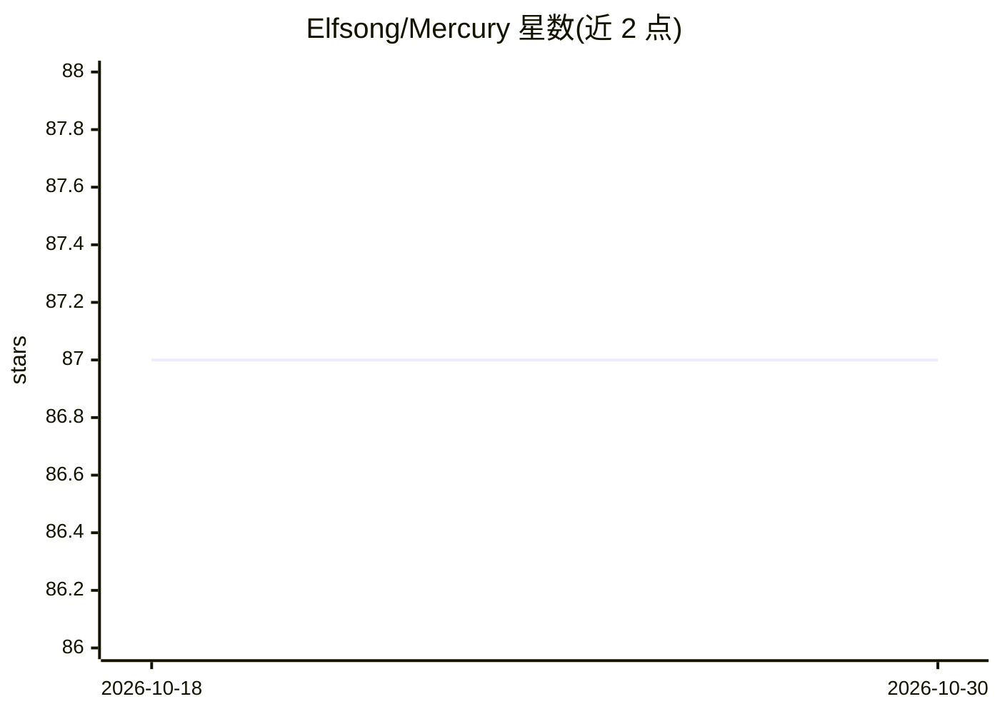

# Elfsong/Mercury

⭐ 87 · Jupyter Notebook · 推送 2026-03-06 · [GitHub](https://github.com/Elfsong/Mercury) · 组织维护

**LLM 代码效率基准：1,889 任务评估生成代码的时间效率**

面向代码大语言模型的效率基准数据集：包含 1,889 个覆盖不同难度的编程任务，配套可生成不限量测试用例的生成器，以运行时间维度评估 LLM 所生成代码的效率。数据集发布于 HuggingFace（Mercury@HF），评估可通过 Mercury_Eval 仓库源码运行，也支持接入 BigCode 评估框架或以 Python 库方式调用（需设置 OPENAI_API_KEY）。论文被 NeurIPS 2024 接收；后续扩展数据集 Venus 支持更多语言并增加内存测量。

## 筛选速览

| 维度 | 判定 | 备注 |
|---|---|---|
| AI 角色 | `ai-knowledge` | 知识聚合/清单类 |
| 许可风险 | `none` | — |
| 部署形态 | `None` |  |
| 模型依赖 | — | README 未给出锁定关系 |
| 硬件要求 | — | 无带数字的原话,不猜 |
| 安装摩擦 | `low` | 无编译、无系统依赖或容器化 |
| 成熟度 | — | 结构信号不足 |

## 能力要点

- 1,889 个编程任务、多难度级别
- 测试用例生成器可产生不限量用例
- 支持 Mercury_Eval、BigCode harness 与库内调用三种评估方式
- NeurIPS 2024 接收论文，配套 Venus 扩展数据集

## 适用场景

- 评估代码 LLM 生成代码的运行效率
- 对比不同模型在代码效率维度的表现
- 为代码生成研究提供带测试用例生成器的基准数据

## 场景标签

`模型评测` · 领域:评测与运维

## 证据(README 行号)

> L8: * Mercury is the first code efficiency benchmark designed for LLM code synthesis tasks.
> L9: * It consists of 1,889 programming tasks covering diverse difficulty levels, along with test case generators that pr

## 星数曲线

2026-10-18 87 → 2026-10-30 87（+0）

---
*卡片 v1 · prompt 1.4 · 生成 2026-10-24 · 置信度 high · 依据 README sha `69e69a05bb72` · [字段定义](../../DATASET.md)*
