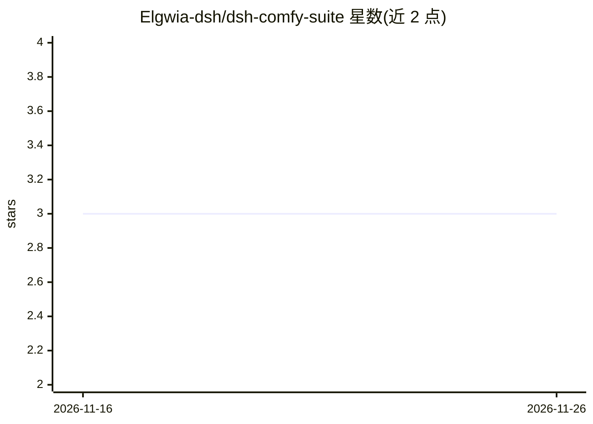

# Elgwia-dsh/dsh-comfy-suite

⭐ 3 · JavaScript · NOASSERTION · 推送 2026-11-25 · [GitHub](https://github.com/Elgwia-dsh/dsh-comfy-suite) · 个人维护 · 中文 README

**把 ComfyUI 接入 DSH 的整合插件：工作流出图与配置面板**

个人整合项目，将三个 MIT 许可的 DSH 插件（工作流库、Qwen 出图/修图/捏人、自建启动器）合并为一个包，附带真机修复与本地功能。以 14 个工具管工作流、出图、修图、捏人、放大与服务启停，配一个设置页与标题栏进度条。前置条件为 DSH >=0.2.1-rc.5、Node >=22.19、Windows 平台及一套可运行的 ComfyUI 安装；vendor 代码锁定固定快照，不承诺跟进上游更新。

## 筛选速览

| 维度 | 判定 | 备注 |
|---|---|---|
| AI 角色 | `ai-ecosystem` | LLM/agent 周边工具 |
| 许可风险 | `none` | NOASSERTION |
| 部署形态 | `desktop` | 安装包/桌面程序 |
| 模型依赖 | — | README 未给出锁定关系 |
| 硬件要求 | — | 无带数字的原话,不猜 |
| 安装摩擦 | `low` | 无编译、无系统依赖或容器化 |
| 成熟度 | — | 结构信号不足 |

## 能力要点

- 14 个模型侧工具覆盖文生图、局部重绘、扩图、捏人、放大与服务启停
- 62 条提示词积木风格库与可复现的提示词衣柜（同 seed 逐字一致）
- 作品库以文件系统为索引，支持换种子再画与同种子复现
- 加载器按扩展名自动选：.safetensors 走原生 UNETLoader，.gguf 走 GGUF 加载器

## 适用场景

- 在 DSH 中通过自然语言调用本地 ComfyUI 出图
- 一站式管理工作流、作品库与提示词素材
- Windows 下零窗口启停 ComfyUI 服务并查看日志

## 场景标签

`图像生成` `图像视频处理` · 领域:内容生成

## 证据(README 行号)

> L17: 把 ComfyUI 接进 DSH：**14 个工具**管工作流、出图、修图、捏人、放大与服务启停，
> L125: - **ComfyUI**：一套能跑的安装（便携版或源码版都行），并在下面「必改配置」里填对路径
> L13: > **只想用其中一个功能，就直接装上游**，不要装这个整合包。本包定位是「合并 + 修复 + 本地增强」，

## 星数曲线

2026-11-16 3 → 2026-11-26 3（+0）

---
*卡片 v1 · prompt 1.4 · 生成 2026-11-26 · 置信度 high · 依据 README sha `5294865fdd37` · [字段定义](../../DATASET.md)*
