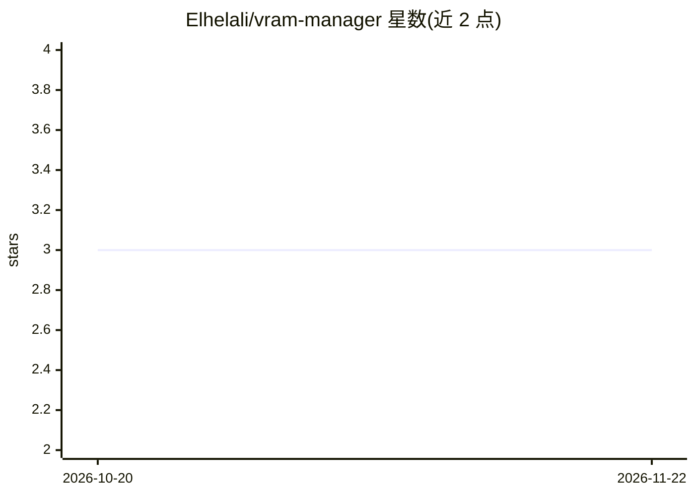

# Elhelali/vram-manager

⭐ 3 · Python · MIT · 推送 2026-10-14 · [GitHub](https://github.com/Elhelali/vram-manager) · [官网](https://elhelali.dev/vram-manager) · 个人维护

**Linux 顶栏 GPU 显存监视器：查看占用进程并可手动结束**

面向 Ubuntu + NVIDIA 环境的 GTK 顶栏应用，以约两秒间隔列出占用 GPU 内存的进程及 CPU/RAM 上下文，支持按阈值与空闲时长发出可选的空闲提醒，用户确认后可请求终止或强制结束进程；Xorg/GNOME 等桌面进程受保护，应用不自动停止任何进程。以 .deb 安装包提供 Ubuntu 24.04 beta，也可从源码运行，无遥测与网络请求。硬件基线为 RTX 5070，多 GPU 与其他发行版未经测试。

## 筛选速览

| 维度 | 判定 | 备注 |
|---|---|---|
| AI 角色 | `ai-enhanced` | 去掉 AI 部分产品仍成立 |
| 许可风险 | `permissive` | MIT |
| 部署形态 | `desktop` | 安装包/桌面程序 |
| 模型依赖 | — | README 未给出锁定关系 |
| 硬件要求 | — | 无带数字的原话,不猜 |
| 安装摩擦 | `medium` | 含编译或系统依赖之一 |
| 成熟度 | `idea` | |

## 能力要点

- 顶栏常驻指示器显示实时 VRAM 用量，点击展开完整窗口
- 按 VRAM 阈值与空闲时长触发可调的空闲提醒（默认 1 GiB/10 分钟）
- 结束/强制结束进程均需确认，不自动停止任何进程
- 无遥测、无网络请求，进程元数据留在本地

## 适用场景

- 本地 LLM/ComfyUI 用完后显存未释放时查看并结束占用进程
- 空闲提醒提示长时间未活动的 GPU 进程
- 了解各进程的显存与 CPU/RAM 占用情况

## 场景标签

 · 领域:系统工具/GPU 监控

## 证据(README 行号)

> L3: **Your local AI server is still holding 8 GB of VRAM, 40 minutes after you stopped using it.** VRAM Manager can flag
> L21: Open **VRAM Manager** from Applications, or run `vram-manager`. You need an NVIDIA driver that provides a working `
> L51: Requires Python 3.10+, Linux with pidfd support, GTK 3/PyGObject, libnotify and SVG support:

## 星数曲线

2026-10-20 3 → 2026-11-22 3（+0）

---
*卡片 v1 · prompt 1.4 · 生成 2026-11-22 · 置信度 high · 依据 README sha `c60d824a3d57` · [字段定义](../../DATASET.md)*
