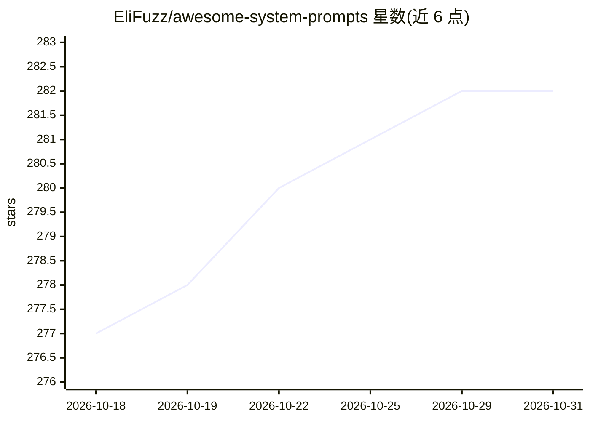

# EliFuzz/awesome-system-prompts

⭐ 282 · JavaScript · GPL-3.0 · 推送 2026-03-06 · [GitHub](https://github.com/EliFuzz/awesome-system-prompts) · [官网](https://elifuzz.github.io/awesome-system-prompts/) · 个人维护

**各 AI 编码助手与 LLM 产品系统提示词的收集清单**

收录 Aider、Claude Code、Cursor、Devin、Codex、Gemini、GPT-4o/GPT-5、Grok、Manus、Microsoft Copilot、Notion 等数十款 AI 编码助手与 LLM 产品的系统提示词及工具定义，按产品分节，每节区分 Latest 与 Archived 条目并附日期版本；部分条目覆盖工具 schema、人格模式、输出样式与安全策略。以目录形式组织，供查阅各产品提示词结构与历史版本，README 本身不提供运行或安装途径。

## 筛选速览

| 维度 | 判定 | 备注 |
|---|---|---|
| AI 角色 | `ai-knowledge` | 知识聚合/清单类 |
| 许可风险 | `viral` | GPL-3.0 |
| 部署形态 | `None` |  |
| 模型依赖 | — | README 未给出锁定关系 |
| 硬件要求 | — | 无带数字的原话,不猜 |
| 安装摩擦 | `low` | 无编译、无系统依赖或容器化 |
| 成熟度 | — | 结构信号不足 |

## 能力要点

- 覆盖数十款 AI 编码助手与 LLM 产品的系统提示词及工具定义
- 按产品分节并区分 Latest 与 Archived 条目，附日期版本
- 条目含工具 schema、人格模式、输出样式、安全策略等类型

## 适用场景

- 查阅各 AI 编码助手的系统提示词与工具定义结构
- 对比不同产品提示词设计随版本的演变
- 为自有 agent 设计提示词时参考业界写法

## 场景标签

`精选清单` `提示工程` · 领域:Agent 开发

## 证据(README 行号)

> L1: # Prompt Labs - Leaked System Prompts
> L85: ### Anthropic & Anthropic: Claude Code

## 星数曲线

2026-10-18 277 → 2026-10-31 282（+5）

---
*卡片 v1 · prompt 1.4 · 生成 2026-10-22 · 置信度 high · 依据 README sha `84de2a12f938` · [字段定义](../../DATASET.md)*
