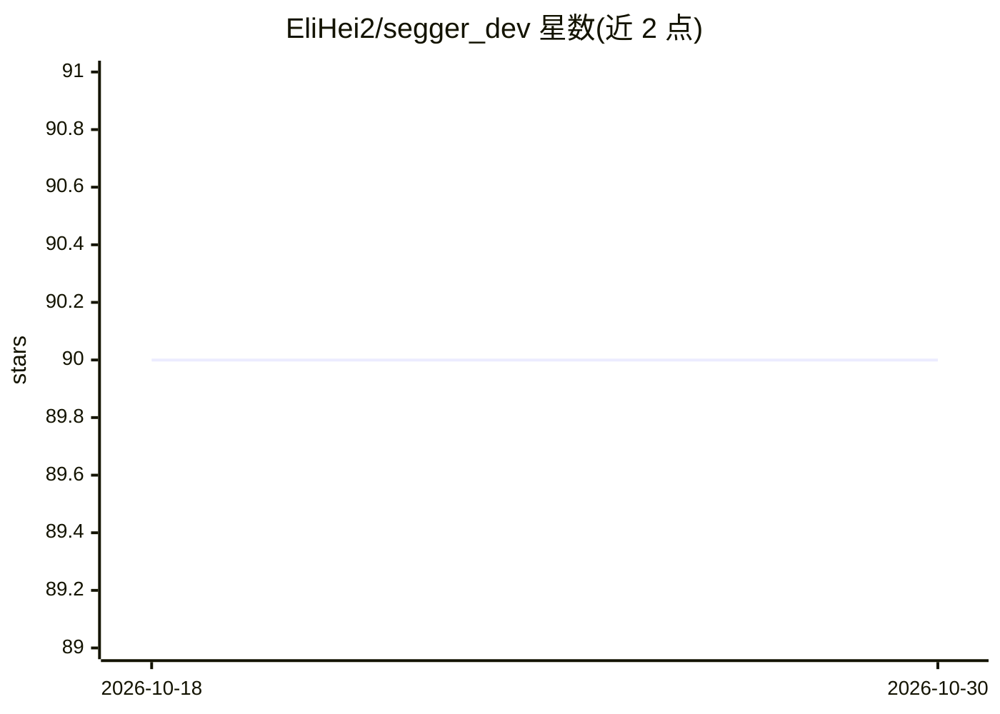

# EliHei2/segger_dev

⭐ 90 · HTML · MIT · 推送 2026-10-12 · [GitHub](https://github.com/EliHei2/segger_dev) · [官网](https://elihei2.github.io/segger_dev/) · 个人维护

**GNN 细胞分割模型：处理图像型空间转录组学数据**

segger_dev 是 segger 的开发版仓库：基于图神经网络的空间转录组学细胞分割方法，将转录本与细胞建模为异构图，把细胞分割转化为转录本-细胞的链接预测问题。安装需先装 PyTorch 与 Lightning，可选 PyG-lib 加速异构图操作（仅支持 CUDA ≤ 12.4、PyTorch ≤ 2.5.0），推荐从 GitHub 克隆源码安装。README 声明 2026 年 3 月已有新的稳定版本迁移至 dpeerlab/segger，本仓库处于活跃开发中。

## 筛选速览

| 维度 | 判定 | 备注 |
|---|---|---|
| AI 角色 | `ai-native` | 本体是模型或模型工具 |
| 许可风险 | `permissive` | MIT |
| 部署形态 | `library` | 以包/库形式分发 |
| 模型依赖 | — | README 未给出锁定关系 |
| 硬件要求 | — | 无带数字的原话,不猜 |
| 安装摩擦 | `medium` | 含编译或系统依赖之一 |
| 成熟度 | `idea` | |

## 能力要点

- 将转录本与细胞建模为异构图
- 细胞分割转化为链接预测问题
- 可选 PyG-lib 加速异构图操作
- 支持 CUDA 12.1 + PyTorch 2.5.0 环境示例

## 适用场景

- 对图像型空间转录组数据做单细胞分割
- 处理 Xenium 等单分子分辨空间组学数据集
- 在肿瘤/单细胞分析流程中提供分割结果

## 场景标签

 · 领域:生物信息学/空间组学

## 证据(README 行号)

> L5: **segger** is a GNN-based method for segmenting image-based spatial transcriptomics data. It models transcripts and 
> L28: **March 2025:** Since **segger** is under active development, we recommend installing the latest version directly f

## 星数曲线

2026-10-18 90 → 2026-10-30 90（+0）

---
*卡片 v1 · prompt 1.4 · 生成 2026-10-23 · 置信度 mid · 依据 README sha `9be2e10944d5` · [字段定义](../../DATASET.md)*
