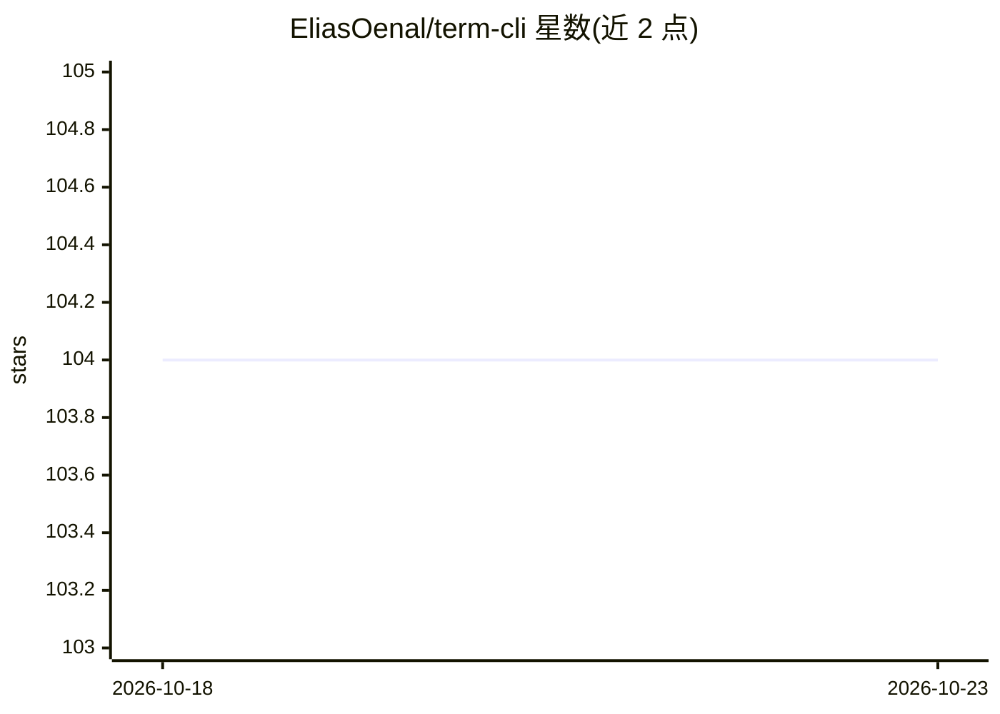

# EliasOenal/term-cli

⭐ 104 · Python · BSD-3-Clause-Clear · 推送 2026-08-04 · [GitHub](https://github.com/EliasOenal/term-cli) · 个人维护

**让 AI agent 运行交互式终端程序的工具**

面向 AI coding agent 的终端会话工具：基于 tmux 的分离会话中运行交互程序（调试器、SSH、安装器、REPL、TUI 等），agent 通过 CLI 命令发送按键、捕获屏幕、等待提示符与传输文件；对密码、MFA 等环节可请求人类经 term-assist 加入协助，也支持人类主导、agent 观察的锁定会话模式。单文件 Python，除 tmux 外无依赖，含 700+ 测试，附带 Agent Skill 文件与安装脚本。

## 筛选速览

| 维度 | 判定 | 备注 |
|---|---|---|
| AI 角色 | `ai-ecosystem` | LLM/agent 周边工具 |
| 许可风险 | `viral` | BSD-3-Clause-Clear |
| 部署形态 | `None` |  |
| 模型依赖 | — | README 未给出锁定关系 |
| 硬件要求 | — | 无带数字的原话,不猜 |
| 安装摩擦 | `low` | 无编译、无系统依赖或容器化 |
| 成熟度 | — | 结构信号不足 |

## 能力要点

- tmux 支撑的分离会话：start/run/send-text/send-key/capture/wait 等 20+ 命令
- request/term-assist 人类协作通道处理密码、MFA 与手动步骤
- 锁定会话支持人类驱动、agent 观察模式
- upload/download 文件传输（gzip 压缩、SHA-256 校验、管道支持）

## 适用场景

- 让 coding agent 运行 pdb/gdb 调试器并逐步交互
- agent 处理 SSH 密码/MFA 提示时把控制权交给人
- agent 应对 debconf 安装器、GRUB/串口控制台等无法 --yes 略过的交互流程

## 场景标签

 · 领域:开发者工具/Agent 基础设施

## 证据(README 行号)

> L8: Run interactive programs from your AI coding agent without blocking. Dev servers, debuggers, REPLs, databases, edito
> L16: - **term-cli**: Agents run interactive programs in detached terminal sessions (tmux-backed)

## 星数曲线

2026-10-18 104 → 2026-10-23 104（+0）

---
*卡片 v1 · prompt 1.4 · 生成 2026-10-23 · 置信度 high · 依据 README sha `c8661c8641fa` · [字段定义](../../DATASET.md)*
