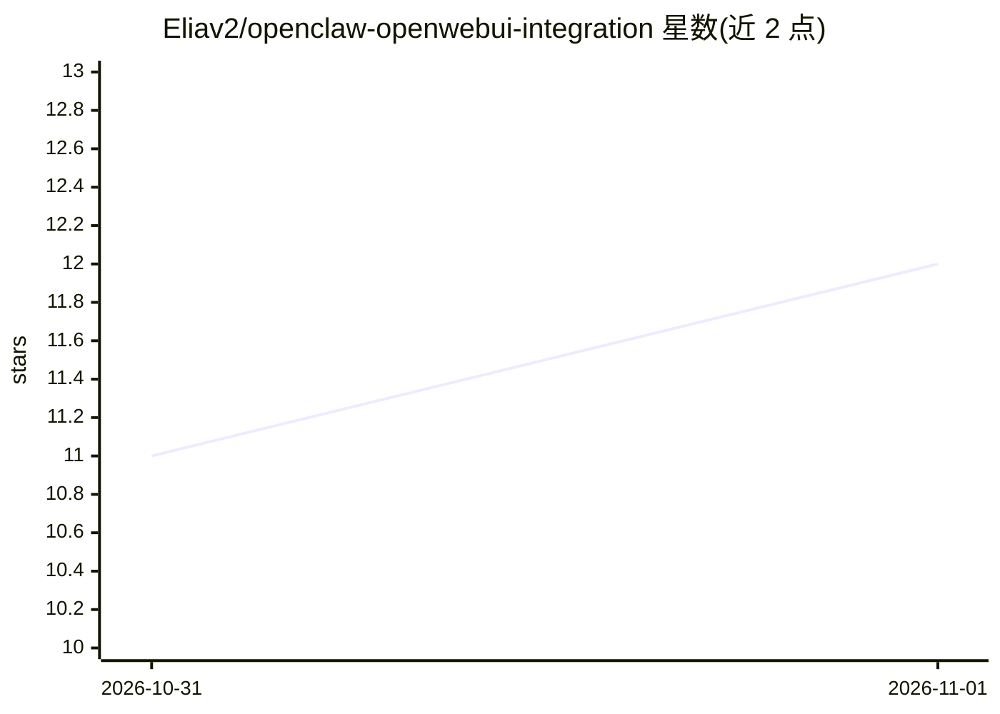

# Eliav2/openclaw-openwebui-integration

⭐ 12 · Python · MIT · 推送 2026-10-31 · [GitHub](https://github.com/Eliav2/openclaw-openwebui-integration) · [官网](https://eliav2.github.io/openclaw-openwebui-integration/) · 个人维护

**将 OpenClaw agent 接入 Open WebUI 的对话集成组件**

连接层组件：通过 Open WebUI 聊天界面操作已运行的 OpenClaw agent，经 Gateway 原生协议通信，自身不是 agent。提供实时工具调用卡片、以选择题卡片形式向用户提问、子 agent 独立卡片与状态对话框（上下文、速率限制、子 agent 进度）。支持运行中插话、页面/服务重启后回复延续、cron 任务与子 agent 结果主动回帖、频道内 @ 触发跟随。安装需 uv，经 git clone 与 install.py 向导完成，并需在 Gateway 主机批准设备。安全注意：集成以 agent 全权限驱动，能与其聊天者即拥有同等权限。

## 筛选速览

| 维度 | 判定 | 备注 |
|---|---|---|
| AI 角色 | `ai-ecosystem` | LLM/agent 周边工具 |
| 许可风险 | `permissive` | MIT |
| 部署形态 | `None` |  |
| 模型依赖 | — | README 未给出锁定关系 |
| 硬件要求 | — | 无带数字的原话,不猜 |
| 安装摩擦 | `low` | 无编译、无系统依赖或容器化 |
| 成熟度 | — | 结构信号不足 |

## 能力要点

- 工具调用以实时卡片展示，可查看命令与输出
- agent 决策以选择题卡片交互，子 agent 独立卡片跟踪
- 运行中可插话；页面或服务重启后回复在同一消息中完成
- 模型选择器列出 Gateway 允许的全部模型，每聊天一个会话

## 适用场景

- 在自托管 Open WebUI 界面里直接指挥并观察 OpenClaw agent 工作
- 通过选择题卡片对 agent 执行中的决策做人工确认
- 在频道中 @ agent 并让其跟随线程回答

## 场景标签

`聊天机器人` · 领域:对话与助手

## 证据(README 行号)

> L9: Chat with your OpenClaw agents from Open WebUI and watch them work: tool calls as cards, questions as dialogs, sub-a
> L10: It connects to your running Gateway over its native protocol; it is not an agent itself.
> L14: On any machine that can reach Open WebUI (needs uv):

## 星数曲线

2026-10-31 11 → 2026-11-01 12（+1）

---
*卡片 v1 · prompt 1.4 · 生成 2026-11-01 · 置信度 high · 依据 README sha `35ab41adf6e8` · [字段定义](../../DATASET.md)*
