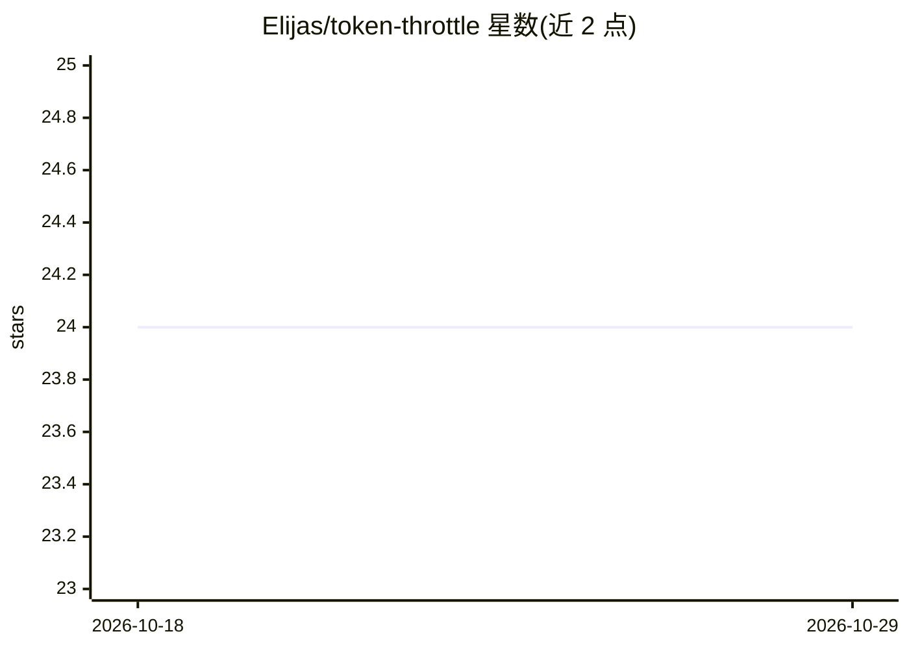

# Elijas/token-throttle

⭐ 24 · Python · Apache-2.0 · 推送 2026-10-22 · [GitHub](https://github.com/Elijas/token-throttle) · 个人维护

**LLM API 多资源限流库：预留 token、用后退还、跨进程共享配额**

Python 限流库，面向并发调用 LLM API 的开发场景：调用前按声明上限预留容量（请求/输入/输出 token 多资源、多时间窗口），调用后按实际用量退还差额，避免按最坏情况预留造成的吞吐浪费或 429。基于令牌桶算法，后端可选 memory、SQLite（单机多进程共享）或 Redis（跨机器共享，仅支持 standalone/Sentinel），提供 OpenAI 内置适配器、Anthropic 示例与任意 provider 的手动模式。自述 beta，要求 Python 3.12+，Redis 后端需 6.2+（测试覆盖自 7.2 起），不支持 Redis Cluster。

## 筛选速览

| 维度 | 判定 | 备注 |
|---|---|---|
| AI 角色 | `ai-ecosystem` | LLM/agent 周边工具 |
| 许可风险 | `permissive` | Apache-2.0 |
| 部署形态 | `library` | 以包/库形式分发 |
| 模型依赖 | — | README 未给出锁定关系 |
| 硬件要求 | — | 无带数字的原话,不猜 |
| 安装摩擦 | `low` | 无编译、无系统依赖或容器化 |
| 成熟度 | `idea` | |

## 能力要点

- 多资源（请求/输入/输出 token）× 多时间窗口同时限流
- 预留-退还机制按实际用量归还容量，跨进程经 SQLite/Redis 共享预算
- 按 model_family 配置每模型配额，支持运行时动态调整限额
- 框架无关的可观测接口：日志、回调、健康快照

## 适用场景

- 批量任务或 agent 并发调用 LLM API 时避免 429 且不浪费吞吐
- 多个服务共享同一 API key 时跨机器协调配额
- 按模型分别设置请求/分钟与 token/天等复合限额

## 场景标签

 · 领域:LLM 基础设施/流量控制

## 证据(README 行号)

> L13: **Multi-resource rate limiting for LLM APIs.** Reserve tokens before you call, refund what you don't use, stay unde
> L15: Works with any LLM provider and any client library — token-throttle limits the _rate_, not the _client_.

## 星数曲线

2026-10-18 24 → 2026-10-29 24（+0）

---
*卡片 v1 · prompt 1.4 · 生成 2026-10-27 · 置信度 high · 依据 README sha `1cc8956f4218` · [字段定义](../../DATASET.md)*
