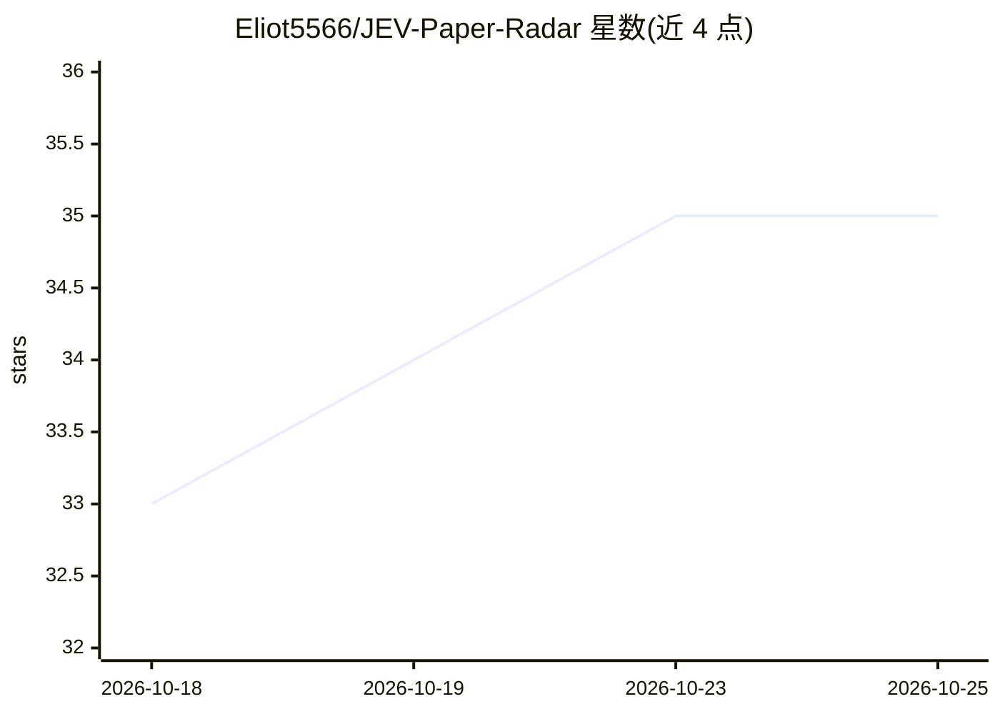

# Eliot5566/JEV-Paper-Radar

⭐ 35 · Python · MIT · 推送 2026-10-23 · [GitHub](https://github.com/Eliot5566/JEV-Paper-Radar) · [官网](https://eliot5566.github.io/JEV-Paper-Radar/public/) · 个人维护 · 中文 README

**每日扫描 arXiv 新论文、按兴趣输出必读清单的工具**

通过 GitHub Actions 定时运行的论文筛选工具：读取 arXiv/bioRxiv/PubMed/Hugging Face 等源的 RSS 或 API，对每篇新论文用 Jev 模型（TypeSafe System One，可经 OpenRouter 访问）按用户以平实英文描述的兴趣逐条做是/否判断并返回概率，再按阈值生成网页、RSS feed、Slack/Discord/Telegram 摘要与审计日志。用户 fork 仓库、配置 radar.toml 与 API key 即可运行，无需服务器；标称全 arXiv 每日约 $0.06。另含基于标注的阈值校准命令与面向系统综述的筛选模式。

## 筛选速览

| 维度 | 判定 | 备注 |
|---|---|---|
| AI 角色 | `ai-native` | 本体是模型或模型工具 |
| 许可风险 | `permissive` | MIT |
| 部署形态 | `library` | 以包/库形式分发 |
| 模型依赖 | — | README 未给出锁定关系 |
| 硬件要求 | — | 无带数字的原话,不猜 |
| 安装摩擦 | `low` | 无编译、无系统依赖或容器化 |
| 成熟度 | — | 结构信号不足 |

## 能力要点

- 每篇论文按兴趣逐条做概率判断而非生成摘要，覆盖全部每日新论文
- 来源覆盖 arXiv/bioRxiv/medRxiv/PubMed/Hugging Face/任意 RSS/Reddit/Bluesky
- 👍/👎 反馈经 GitHub issue 回收，calibrate 拟合个人阈值并报告 Brier 分数
- 提供无需 API key 的离线 demo（paper-radar demo）

## 适用场景

- 每天早上收到按我研究兴趣筛选的 arXiv 必读论文清单
- 系统综述的标题摘要初筛阶段辅助筛选
- 订阅某个细分领域的论文 RSS feed 而不自己搭建服务

## 场景标签

`科研工具` · 领域:学习与行业

## 证据(README 行号)

> L15: Most AI tools read a paper and write you a summary. **Paper Radar does not write anything.** It asks Jev — TypeSafe
> L17: Judgement instead of prose is what makes the arithmetic work. There is nothing to parse and no invented labels, and
> L33: Seven radars run here every weekday. Take the RSS link for your field — nothing to install, no key, no account:

## 星数曲线

2026-10-18 33 → 2026-10-25 35（+2）

---
*卡片 v1 · prompt 1.4 · 生成 2026-10-25 · 置信度 high · 依据 README sha `c75cd4d8c3d3` · [字段定义](../../DATASET.md)*
