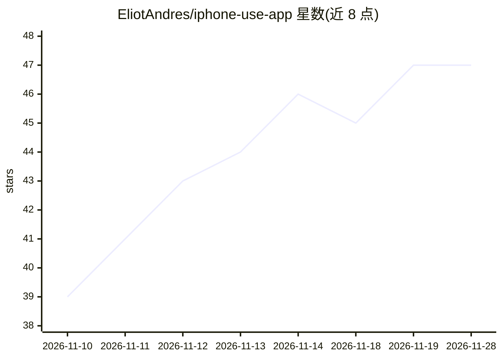

# EliotAndres/iphone-use-app

⭐ 47 · C · AGPL-3.0 · 推送 2026-11-16 · [GitHub](https://github.com/EliotAndres/iphone-use-app) · 个人维护

**在 iPhone 本机运行的 LLM 手机操控 Agent 应用**

iOS 应用，让视觉语言模型操控其所在的 iPhone：通过开发者镜像与回环 VPN 截图并注入触控，每步将截图发给模型，模型以工具调用（点击、滑动、输入、打开应用）驱动任务直至完成。运行时无需 Mac（仅一次性配对文件需要），无需越狱或额外硬件，仅限侧载安装。需 OpenRouter key 或任意兼容 OpenAI 的视觉模型端点；含 11 步回放基准脚本与脚本化运行模式。限制：不能与其他 VPN 并存、蜂窝网络需切换快捷指令、不能上架 App Store。

## 筛选速览

| 维度 | 判定 | 备注 |
|---|---|---|
| AI 角色 | `ai-native` | 本体是模型或模型工具 |
| 许可风险 | `viral` | AGPL-3.0 |
| 部署形态 | `None` |  |
| 模型依赖 | locked-api |  |
| 硬件要求 | — | 无带数字的原话,不猜 |
| 安装摩擦 | `medium` | 含编译或系统依赖之一 |
| 成熟度 | — | 结构信号不足 |

## 能力要点

- 运行时无 Mac、无额外硬件、无越狱：Agent 在 iPhone 上控制本机
- 截图→LLM 工具调用循环（tap/长按/滑动/输入/打开应用）
- 支持 Siri、快捷指令与 iphoneuse:// 链接启动
- scripts/eval.sh 回放 11 步基准，多模型对比正确率与耗时

## 适用场景

- 让 AI 代替我操作手机上的 App 完成任务
- 从 Siri 或快捷指令发起自动化手机操作
- 用脚本模式无 LLM 重放固定操作序列做测试

## 场景标签

`GUI 自动化` · 领域:效率与自动化

## 证据(README 行号)

> L5: **Let an AI model use your iPhone, from the iPhone itself. No Mac at run time (one-time pairing only), no extra hard
> L68: Each step, the screenshot goes to the model, which answers with a tool call (tap, long press, swipe, type, open app

## 星数曲线

2026-11-10 39 → 2026-11-28 47（+8）

---
*卡片 v1 · prompt 1.4 · 生成 2026-11-18 · 置信度 high · 依据 README sha `582213d5bdd1` · [字段定义](../../DATASET.md)*
