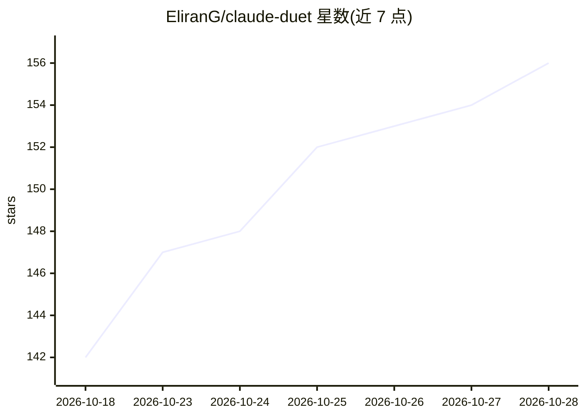

# EliranG/claude-duet

⭐ 156 · TypeScript · MIT · 推送 2026-09-08 · [GitHub](https://github.com/EliranG/claude-duet) · [官网](https://www.npmjs.com/package/claude-duet) · 个人维护

**双人实时共享 Claude Code 会话的 P2P 加密协作 CLI 工具**

面向已安装 Claude Code 的开发者，提供终端内的双人实时协作：一端以 host 方式在无头模式运行 Claude Code，另一端通过 join 命令接入；双方可纯文字聊天，用 @claude 前缀共同向 Claude 发送提示词并实时看到流式回复。默认走 WebRTC P2P 直连（无服务器中转），数据经 NaCl secretbox + scrypt 端到端加密，另有 localtunnel、SSH、Cloudflare 隧道等连接模式。默认开启审批模式，host 逐条审核对方发给 Claude 的提示词，会话历史与 Claude Code 打通可续接。需 Node.js 18+ 与 Claude Code CLI。

## 筛选速览

| 维度 | 判定 | 备注 |
|---|---|---|
| AI 角色 | `ai-ecosystem` | LLM/agent 周边工具 |
| 许可风险 | `permissive` | MIT |
| 部署形态 | `library` | 以包/库形式分发 |
| 模型依赖 | locked-api |  |
| 硬件要求 | — | 无带数字的原话,不猜 |
| 安装摩擦 | `low` | 无编译、无系统依赖或容器化 |
| 成熟度 | — | 结构信号不足 |

## 能力要点

- WebRTC P2P 直连 + NaCl secretbox/scrypt 端到端加密，数据路径无服务器
- @claude 前缀共享提示词，双方实时看到流式响应
- 默认审批模式：host 审核伙伴的每条 Claude 提示词
- 通过 --continue 与 Claude Code 会话历史互通，P2P/LAN/SSH/Cloudflare 多种连接模式

## 适用场景

- 和同事在同一个 Claude Code 会话里结对编程或头脑风暴
- 向他人现场演示 Claude Code 的工作过程
- 两地开发者围绕 PR 与 Claude 一起做代码审查
- 带新队友边看边参与 Claude 搭建服务以熟悉代码库

## 场景标签

 · 领域:开发者工具/AI 协作

## 证据(README 行号)

> L9: Share your Claude Code session with a friend — real-time collaboration for AI pair programming.
> L74: - **Host** runs Claude Code on their machine in headless mode
> L75: - **Partner** connects directly via WebRTC data channel (no server in between)

## 星数曲线

2026-10-18 142 → 2026-10-28 156（+14）

---
*卡片 v1 · prompt 1.4 · 生成 2026-10-22 · 置信度 high · 依据 README sha `47619f31fa17` · [字段定义](../../DATASET.md)*
