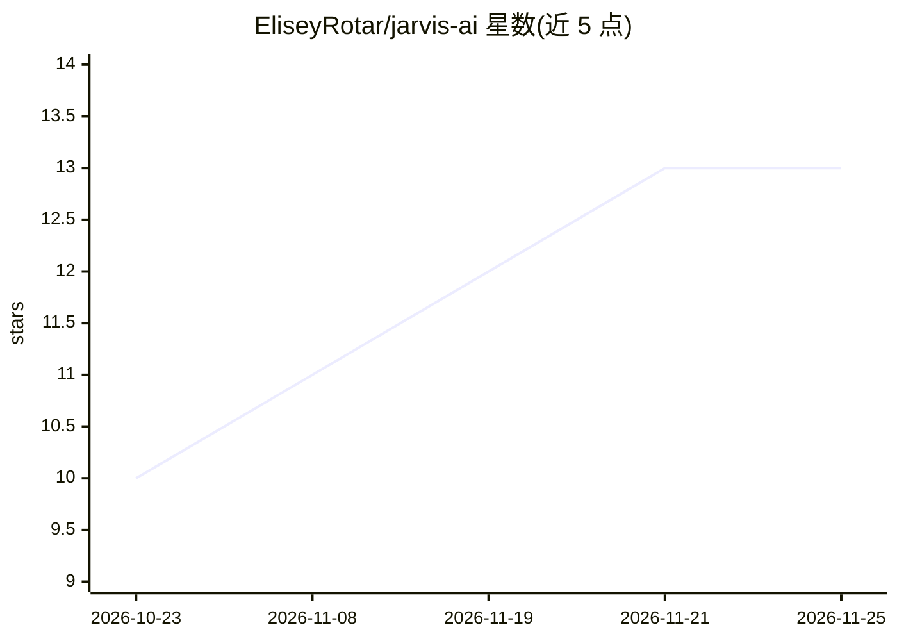

# EliseyRotar/jarvis-ai

⭐ 13 · Python · MIT · 推送 2026-11-11 · [GitHub](https://github.com/EliseyRotar/jarvis-ai) · 个人维护

**Windows 11 语音助手：唤醒词对话、代码编写与后台电脑操作**

运行于 Windows 11 的个人语音助手项目：openwakeword 唤醒词、NVIDIA Parakeet v3 本地语音转写、edge-tts 语音回复，支持意大利语/英语/俄语。对话经本地 Hermes Agent 网关路由到 Gemini Flash 与 Claude 模型；代码类请求开启 Claude Code 会话并提供 git diff 审查视图；电脑操作类请求走 shell、Firefox 扩展与 Cua Driver；事实以 fastembed 嵌入存入 Qdrant 实现长期记忆。危险操作默认需语音或按钮确认。仅监听 127.0.0.1 且无鉴权。

## 筛选速览

| 维度 | 判定 | 备注 |
|---|---|---|
| AI 角色 | `ai-native` | 本体是模型或模型工具 |
| 许可风险 | `permissive` | MIT |
| 部署形态 | `desktop` | 安装包/桌面程序 |
| 模型依赖 | locked-api |  |
| 硬件要求 | — | 无带数字的原话,不猜 |
| 安装摩擦 | `medium` | 含编译或系统依赖之一 |
| 成熟度 | — | 结构信号不足 |

## 能力要点

- openwakeword 唤醒词 + Parakeet v3 本地转写 + edge-tts 多语言流式语音回复
- Hermes Agent 网关按难度在 Gemini Flash 与 Claude Haiku/Sonnet/Opus 间路由
- Claude Code 会话视图：工具调用、git diff 审查面板、文件查看器与终端
- Qdrant 本地向量存储的长期记忆与后台 UI Automation 电脑操作

## 适用场景

- 在 Windows 11 上用语音与我对话并执行提醒、搜索、WhatsApp 等任务
- 让助手在指定文件夹里编写和修改代码并审查改动
- 通过语音让助手打开应用、操作 Firefox 和桌面程序

## 场景标签

`语音 Agent` `AI 助手` `编码 Agent` `GUI 自动化` · 领域:效率与自动化

## 证据(README 行号)

> L3: A voice assistant that lives on a Windows 11 PC. Say "hey Jarvis", talk to it
> L27: Claude Code session (Claude Agent SDK) opens in its own full-screen view, laid

## 星数曲线

2026-10-23 10 → 2026-11-25 13（+3）

---
*卡片 v1 · prompt 1.4 · 生成 2026-11-19 · 置信度 high · 依据 README sha `0ed74b588f7c` · [字段定义](../../DATASET.md)*
