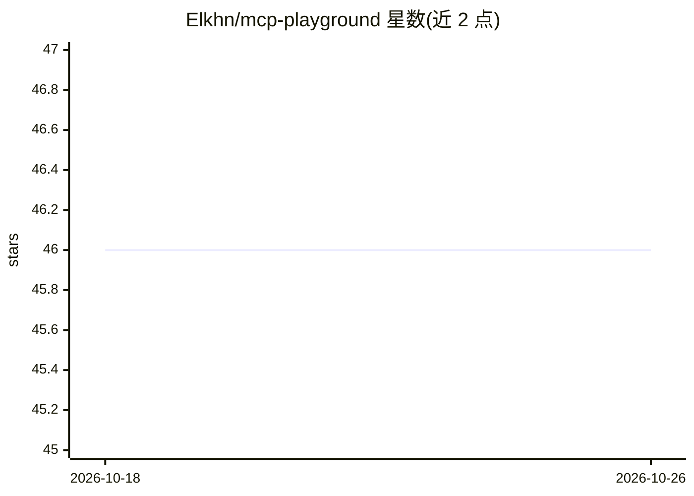

# Elkhn/mcp-playground

⭐ 46 · Python · 推送 2026-03-05 · [GitHub](https://github.com/Elkhn/mcp-playground) · 个人维护

**基于 Streamlit 的多 MCP 工具 LLM 对话应用，Docker 编排**

以 Streamlit 构建的 LLM 聊天界面，通过 Model Context Protocol (MCP) 接入外部工具服务器：内置 Weather 与 Currency 两个 FastMCP 示例服务，由 docker compose 一键编排启动。客户端基于 LangChain + LangGraph 的 create_react_agent 实现工具自动选择与调用，支持 OpenAI、Bedrock、Anthropic、Google、Groq 五类提供商在 UI 中切换并覆盖默认模型 ID。MCP 服务器可在侧边栏动态增删（sse/http 传输），工具调用以 YAML 块流式回显。面向想在本地搭建带工具调用能力的 LLM 试验场的开发者。

## 筛选速览

| 维度 | 判定 | 备注 |
|---|---|---|
| AI 角色 | `ai-native` | 本体是模型或模型工具 |
| 许可风险 | `none` | — |
| 部署形态 | `self-host` | docker 或自建部署 |
| 模型依赖 | locked-api |  |
| 硬件要求 | — | 无带数字的原话,不猜 |
| 安装摩擦 | `low` | 无编译、无系统依赖或容器化 |
| 成熟度 | — | 结构信号不足 |

## 能力要点

- 多 MCP 服务器注册，agent 自动发现工具并路由调用
- 五种 LLM 提供商 UI 内切换并支持自定义模型 ID 覆盖
- 通过 UI 动态添加/移除 MCP 服务器（sse/http 传输）
- 客户端与各 MCP 服务独立 Dockerfile，docker compose 一键启动，uv 管理依赖

## 适用场景

- 本地搭建可插拔 MCP 工具的 LLM 对话试验场
- 对比不同提供商/模型在工具调用任务上的表现
- 快速验证自建 MCP 服务器与 agent 的对接

## 场景标签

`聊天机器人` · 领域:对话与助手

## 证据(README 行号)

> L3: A **Streamlit-based playground** that lets you chat with large language models and seamlessly plug in external **Mul
> L19: |🔌 **Multi-Server MCP**|Register any number of MCP servers; the agent auto-detects available tools & routes calls.|

## 星数曲线

2026-10-18 46 → 2026-10-26 46（+0）

---
*卡片 v1 · prompt 1.4 · 生成 2026-10-25 · 置信度 high · 依据 README sha `9103c6e0489e` · [字段定义](../../DATASET.md)*
