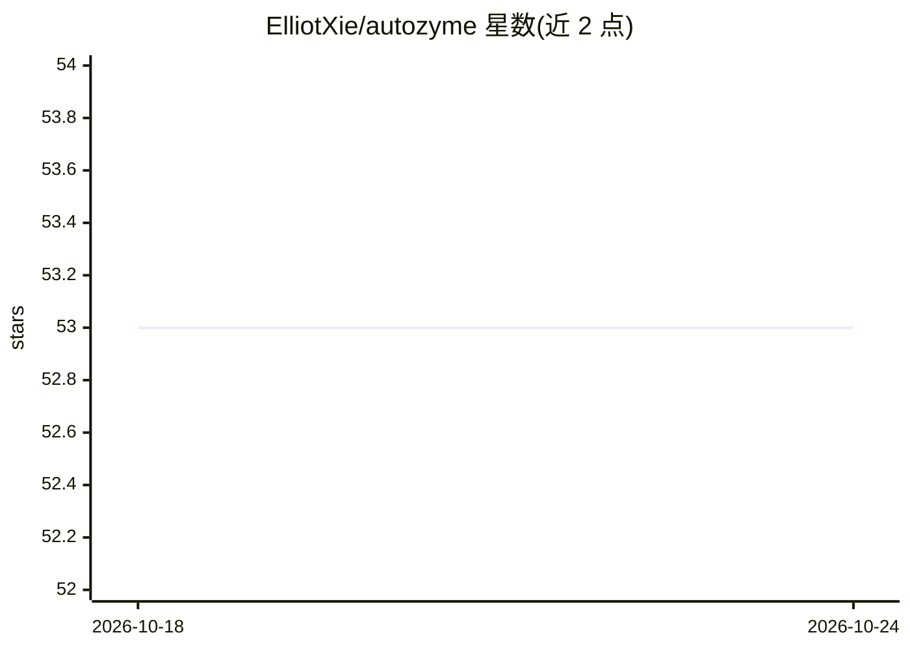

# ElliotXie/autozyme

⭐ 54 · Python · MIT · 推送 2026-09-13 · [GitHub](https://github.com/ElliotXie/autozyme) · [官网](https://www.autozyme.com) · 组织维护

**加速科学软件的多智能体框架，CPU 提速且保持结果一致**

AutoZyme 提供两条路径：一是安装 AutoZyme-Library，获得 Seurat、Scanpy 及 30+ 科学计算包的即插即用加速补丁，调用方式与原函数一致；二是运行其多智能体流水线（scaffold、init、validate、iterate、scaling、package 六阶段），由任意可执行 shell 命令的编码 agent（Claude Code、Codex、Cursor 等）驱动，优化框架尚未内置的函数，典型耗时 4-10 小时。优化结果需通过 OOD 与多线程稳健性验证。R 包安装时需编译 C++ 内核，Windows 需先装 Rtools。面向生物信息学与科学计算开发者，附 HuggingFace 基准数据集与预印本。

## 筛选速览

| 维度 | 判定 | 备注 |
|---|---|---|
| AI 角色 | `ai-ecosystem` | LLM/agent 周边工具 |
| 许可风险 | `permissive` | MIT |
| 部署形态 | `library` | 以包/库形式分发 |
| 模型依赖 | — | README 未给出锁定关系 |
| 硬件要求 | — | 无带数字的原话,不猜 |
| 安装摩擦 | `low` | 无编译、无系统依赖或容器化 |
| 成熟度 | — | 结构信号不足 |

## 能力要点

- Seurat/Scanpy 等 30+ 包的 drop-in 加速补丁，调用方式不变
- 六阶段自主优化流水线，可接入任意编码 agent
- 50 轮迭代优化循环与 OOD/多线程稳健性验证
- 基准数据集托管于 HuggingFace

## 适用场景

- 给现有 Seurat/Scanpy 分析代码提速且不改调用方式
- 用编码 agent 自动优化尚未有补丁的科学计算函数
- 生物信息学软件性能优化的基准复现

## 场景标签

`多智能体` `编码 Agent` · 领域:Agent 开发

## 证据(README 行号)

> L3: **AutoZyme** is an autonomous multi-agent framework that speeds up scientific software on CPUs while preserving the 
> L39: AutoZyme can also optimize functions it doesn't ship yet, driven by any coding agent that can run shell commands (C
> L97:   title   = {AutoZyme: An Autonomous Agentic Framework to Optimize Bioinformatics Software},

## 星数曲线

2026-10-18 53 → 2026-10-24 53（+0）

---
*卡片 v1 · prompt 1.4 · 生成 2026-10-24 · 置信度 high · 依据 README sha `d5fc0afb3bfa` · [字段定义](../../DATASET.md)*
