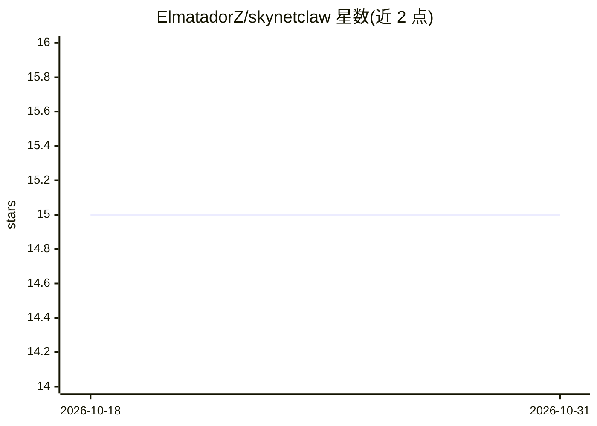

# ElmatadorZ/skynetclaw

⭐ 15 · Python · Apache-2.0 · 推送 2026-08-04 · [GitHub](https://github.com/ElmatadorZ/skynetclaw) · [官网](https://github.com/ElmatadorZ/skynetclaw/wiki) · 个人维护

**本地优先的多智能体议会系统：14 个 agent 持久记忆、自评与治理**

基于 FastAPI + SQLite 的本地运行多智能体应用：14 个成员（指挥官、分析者、怀疑者、审计者等）并行审议并收敛结论；核心机制为机构记忆（SQLite + Obsidian 持久化）、对自身预测按 7/30/90/180 天复盘评分、按宪法强制执行的治理引擎（拒绝无证据声明、保留并追踪少数意见）、贝叶斯成员声誉与共享认知状态（House Mind）。模型无关：默认 Ollama 本地运行，也可接 llama.cpp 或云端 API；推理与执行可配置不同模型。默认未沙箱化，靠 deny-by-default 权限门控不可逆操作。面向希望在自有机器上运行带记忆与治理的 agent 议会的用户。

## 筛选速览

| 维度 | 判定 | 备注 |
|---|---|---|
| AI 角色 | `ai-native` | 本体是模型或模型工具 |
| 许可风险 | `permissive` | Apache-2.0 |
| 部署形态 | `self-host` | docker 或自建部署 |
| 模型依赖 | local-ok | 支持本地模型 |
| 硬件要求 | `cpu-ok` | |
| 安装摩擦 | `low` | 无编译、无系统依赖或容器化 |
| 成熟度 | — | 结构信号不足 |

## 能力要点

- 14 个 agent 并行审议，记忆持久化于 SQLite 并可归档到 Obsidian
- 预测按 7/30/90/180 天复盘评分，信念携带 trust_basis 信任凭据（'Prove it' 查询）
- 治理引擎强制执行宪法：无证据声明被拒绝，少数意见被保留与追踪
- 模型无关：Ollama/llama.cpp/vLLM 及多个云 API，推理与执行模型分离配置

## 适用场景

- 在本地机器上运行带持久记忆的多 agent 审议系统
- 追踪 agent 结论的证据来源、异议与历史预测准确率
- 通过 MCP 接入外部工具并隔离其输出权限

## 场景标签

`多智能体` · 领域:Agent 开发

## 证据(README 行号)

> L94: - **Council of 14** — Elite Commander, Atlas, Analyst, Strategist, Skeptic, Auditor, Governor,
> L97: - **Institutional Memory** — every deliberation is persisted, archived (SQLite + Obsidian), and
> L104: - **Governance Engine** — the constitution is enforced, not advisory: forecasts without an

## 星数曲线

2026-10-18 15 → 2026-10-31 15（+0）

---
*卡片 v1 · prompt 1.4 · 生成 2026-10-31 · 置信度 mid · 依据 README sha `0700cf6deea8` · [字段定义](../../DATASET.md)*
