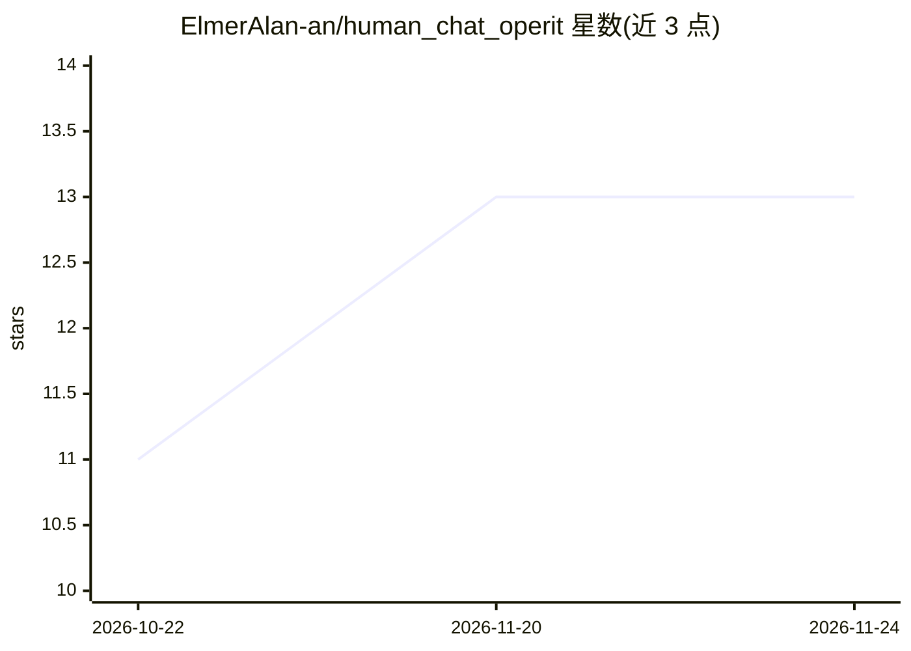

# ElmerAlan-an/human_chat_operit

⭐ 13 · MIT · 推送 2026-05-13 · [GitHub](https://github.com/ElmerAlan-an/human_chat_operit) · 个人维护 · 中文 README

**Operit AI 助手的真人化聊天插件，提供人格与情绪切换**

为 Operit AI 助手提供两种安装形态：Skill 版为轻量 Prompt 文件，放入手机技能目录后重启或刷新生效；ToolPkg 版为 JS 硬检测包，经包管理启用。功能包含 4 种人格风格（自然/幽默/温暖/严肃）、情绪自动切换、情绪强度与混合情绪、时间感知、ngram 反重复检测、System Prompt 注入与 AI 味黑名单过滤，两版本可同时启用互补工作。通过 /human 命令切换风格与表情密度、查看状态。MIT 协议开源。

## 筛选速览

| 维度 | 判定 | 备注 |
|---|---|---|
| AI 角色 | `ai-native` | 本体是模型或模型工具 |
| 许可风险 | `permissive` | MIT |
| 部署形态 | `None` |  |
| 模型依赖 | — | README 未给出锁定关系 |
| 硬件要求 | — | 无带数字的原话,不猜 |
| 安装摩擦 | `low` | 无编译、无系统依赖或容器化 |
| 成熟度 | — | 结构信号不足 |

## 能力要点

- Skill（Prompt）与 ToolPkg（JS 硬检测）双版本，可同时启用互补
- 4 种人格风格与情绪自动切换（/human style auto）
- ngram 反重复硬检测与 AI 味黑名单过滤
- 情绪强度、混合情绪与反讽控制

## 适用场景

- 让 Operit 里的 AI 助手对话输出更接近真人语气
- 按场景切换严肃/幽默/温暖等聊天风格
- 过滤重复与 AI 味表达

## 场景标签

`提示工程` · 领域:Agent 开发

## 证据(README 行号)

> L3: 让 AI 助手在 Operit 中像真人一样随机应变地聊天。
> L5: **双版本提供**：Skill（轻量Prompt） + ToolPkg（硬检测引擎）

## 星数曲线

2026-10-22 11 → 2026-11-24 13（+2）

---
*卡片 v1 · prompt 1.4 · 生成 2026-11-19 · 置信度 high · 依据 README sha `ca136a55e0b4` · [字段定义](../../DATASET.md)*
