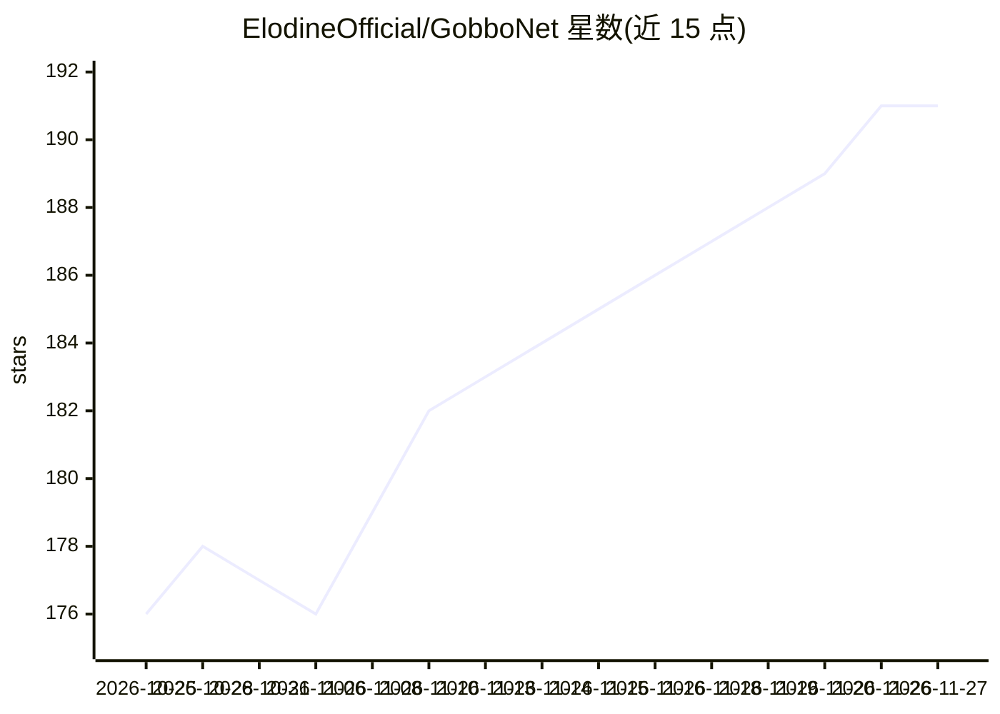

# ElodineOfficial/GobboNet

⭐ 191 · JavaScript · NOASSERTION · 推送 2026-11-15 · [GitHub](https://github.com/ElodineOfficial/GobboNet) · [官网](https://goblincorps.com/gobbonet) · 个人维护

**一键安装的全本地 AI 聊天前端，数据不出本机**

面向非技术用户的本地聊天前端：通过安装包或 ZIP 部署，由 launch.bat 启动器引导设置密码、下载约 300 MB 的 llama.cpp 引擎、按硬件检测推荐并下载模型（通常 4–16 GB），另下载约 146 MB 检索模型以按需引入角色 lorebook 内容。聊天界面在浏览器中打开，可经 LAN 从手机访问；首次配置后可完全离线运行。仅支持 Windows 与 64 位 Linux，不支持 Mac。

## 筛选速览

| 维度 | 判定 | 备注 |
|---|---|---|
| AI 角色 | `ai-native` | 本体是模型或模型工具 |
| 许可风险 | `none` | NOASSERTION |
| 部署形态 | `desktop` | 安装包/桌面程序 |
| 模型依赖 | local-ok | 支持本地模型 |
| 硬件要求 | `gpu-8g` | |
| 安装摩擦 | `low` | 无编译、无系统依赖或容器化 |
| 成熟度 | — | 结构信号不足 |

## 能力要点

- 一键安装与图形化引导（启动器自动检测硬件并推荐模型）
- 下载引擎与模型后可完全离线运行
- 内置检索模型支持角色 lorebook 内容按需引入对话
- 支持手机通过同一 Wi-Fi 的 LAN 访问

## 适用场景

- 在家用自己电脑搭建本地聊天机器人，无需账号和联网
- 在局域网内从手机或平板访问同一聊天界面
- 跑 Llama/Qwen/DeepSeek 等多种开源模型的对话

## 场景标签

`聊天机器人` · 领域:对话与助手

## 证据(README 行号)

> L1: # GobboNet — Your Own Private AI Front End, Now With An Easily Downloaded .exe
> L3: GobboNet lets you run an AI chatbot **on your own computer**, with no accounts, no monthly fees, and nothing sent to
> L96: Next it says the engine isn't installed yet and asks **"Download llama.cpp now?"** Type **Y** and press Enter. This

## 星数曲线

2026-10-25 176 → 2026-11-27 191（+15）

---
*卡片 v1 · prompt 1.4 · 生成 2026-11-26 · 置信度 high · 依据 README sha `e8f6d047ed4e` · [字段定义](../../DATASET.md)*
