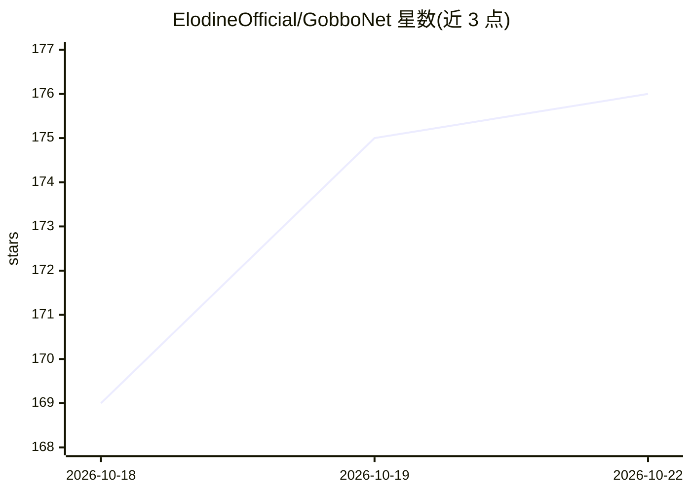

# ElodineOfficial/GobboNet

⭐ 177 · JavaScript · NOASSERTION · 推送 2026-10-19 · [GitHub](https://github.com/ElodineOfficial/GobboNet) · [官网](https://goblincorps.com/gobbonet) · 组织维护

**本地离线运行的 AI 角色扮演聊天前端，Windows 一键安装**

面向非技术用户的 Windows 本地 AI 聊天前端：通过安装器（GobboNetSetup.exe，660 KB，无需管理员权限）一键安装，首次运行由启动器引导下载 llama.cpp 引擎（约 300 MB）、所选模型（4–16 GB）与约 146 MB 的检索模型，此后完全离线运行。支持 Llama、Gemma、DeepSeek、Qwen、gpt-oss、Mistral 等模型，提供角色卡（.png 导入导出）、lorebook 检索注入、多会话管理与可选的局域网手机访问、可选联网搜索。限制：仅 Windows 10/11，需 10–20 GB 磁盘空间，GPU 影响运行速度，LAN 登录密码明文传输。

## 筛选速览

| 维度 | 判定 | 备注 |
|---|---|---|
| AI 角色 | `ai-native` | 本体是模型或模型工具 |
| 许可风险 | `none` | NOASSERTION |
| 部署形态 | `desktop` | 安装包/桌面程序 |
| 模型依赖 | local-ok | 支持本地模型 |
| 硬件要求 | — | 无带数字的原话,不猜 |
| 安装摩擦 | `low` | 无编译、无系统依赖或容器化 |
| 成熟度 | — | 结构信号不足 |

## 能力要点

- 一键安装器与首次运行的引导式模型选择（按硬件检测推荐模型）
- 完全本地离线运行，模型数据不出本机
- 角色卡 .png 导入导出与 lorebook 检索注入（独立检索模型跑在 CPU 上）
- 可选局域网访问：同一 Wi-Fi 下从手机浏览器聊天

## 适用场景

- 在自家电脑上离线进行 AI 角色扮演聊天，数据不外传
- 导入已有的 .png 角色卡继续使用既有角色收藏
- 给角色挂载大量背景设定（lorebook）而不占用对话上下文
- 手机连同一 Wi-Fi 在移动端继续对话

## 场景标签

`聊天机器人` · 领域:对话与助手

## 证据(README 行号)

> L3: GobboNet lets you run an AI chatbot **on your own computer**, with no accounts, no monthly fees, and nothing sent to
> L96: Next it says the engine isn't installed yet and asks **"Download llama.cpp now?"** Type **Y** and press Enter. This
> L152: - **Characters.** It comes with a few built-in personalities (a terse coder, a wordy lore-keeper, a riddle-speakin

## 星数曲线

2026-10-18 169 → 2026-10-22 176（+7）

---
*卡片 v1 · prompt 1.4 · 生成 2026-10-22 · 置信度 high · 依据 README sha `6ed2a783be4e` · [字段定义](../../DATASET.md)*
