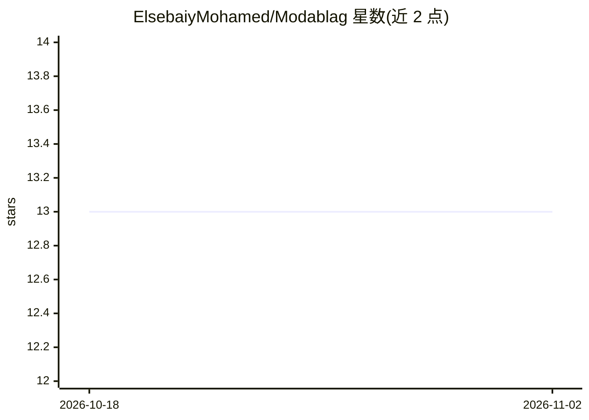

# ElsebaiyMohamed/Modablag

⭐ 13 · Python · MIT · 推送 2026-07-21 · [GitHub](https://github.com/ElsebaiyMohamed/Modablag) · 个人维护

**英译阿自动视频配音系统研究项目（ASR+NMT+TTS）**

一个英译阿拉伯语自动视频配音的研究型项目：从源视频分离音频，经语音翻译（ASR 用 wav2vec 2.0 与 CTC、NMT 用带注意力的 LSTM 编解码、TTS 用 FastSpeech2）生成阿拉伯语语音，再与原视频帧合成配音视频；辅以英文标点模型与阿拉伯语 Tashkeel 加音符模型。系统由 Flutter 应用、应用服务器（localhost/Heroku）、Firebase 数据库与 PyTorch/TensorFlow/HuggingFace 的 ML 流水线组成。README 记录了主观评测中唇形同步、流畅度、术语、方言等待改进方面，未给出安装运行命令。

## 筛选速览

| 维度 | 判定 | 备注 |
|---|---|---|
| AI 角色 | `ai-native` | 本体是模型或模型工具 |
| 许可风险 | `permissive` | MIT |
| 部署形态 | `None` |  |
| 模型依赖 | — | README 未给出锁定关系 |
| 硬件要求 | — | 无带数字的原话,不猜 |
| 安装摩擦 | `low` | 无编译、无系统依赖或容器化 |
| 成熟度 | `idea` | |

## 能力要点

- ASR+NMT+TTS 三段式英译阿配音流水线
- wav2vec 2.0 + CTC 做语音识别，FastSpeech2 做语音合成
- 标点模型与 Tashkeel 加音符模型用于改善翻译与合成质量
- Flutter 客户端 + Heroku 应用服务器 + Firebase 数据库的模块化架构

## 适用场景

- 研究英译阿拉伯语的视频自动配音方法
- 了解 ASR/NMT/TTS 三任务在配音场景的组合实现
- 参考唇形同步、韵律与方言处理等配音难题的评测结论

## 场景标签

`语音识别` `语音合成` · 领域:内容生成

## 证据(README 行号)

> L29: 1. Separating the audio and video from the source English video
> L30: 2. Translating the English audio to Arabic speech using a speech translator
> L31: 3. Preserving the original video frames
> L32: 4. Merging the translated Arabic speech with the video frames to create an Arabic dubbed video

## 星数曲线

2026-10-18 13 → 2026-11-02 13（+0）

---
*卡片 v1 · prompt 1.4 · 生成 2026-10-31 · 置信度 mid · 依据 README sha `42d9a62c5669` · [字段定义](../../DATASET.md)*
