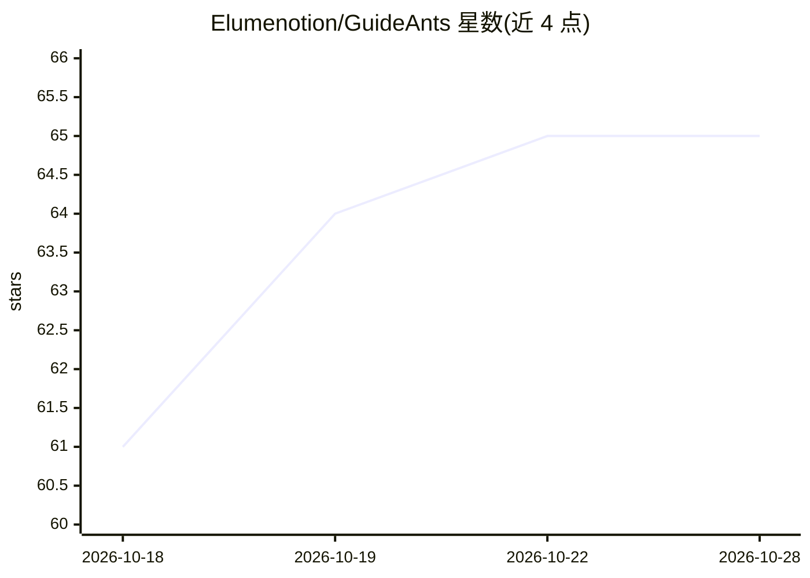

# Elumenotion/GuideAnts

⭐ 65 · C# · Apache-2.0 · 推送 2026-10-28 · [GitHub](https://github.com/Elumenotion/GuideAnts) · [官网](https://www.guideants.ai) · 个人维护

**面向团队的 AI 工作区：把 AI 项目、对话与成果沉淀为可发布资产**

以 Docker Compose 部署的自托管 AI 工作区：项目、笔记本、文件、对话与生成产物存放在同一处，对话以文件与项目上下文为依据。团队可把可复用的工作方式打包为 guides 与 assistants（封装指令、工具、文件、模型选择），通过友好 URL 分享、用 guideants Web 组件嵌入其他应用或经 API 集成，并对发布内容施加访问控制、限额、留存与用量追踪。安装经便携安装包向导完成，AI 后端支持 none/slim/cpu/cuda13/rocm/vulkan，也提供 SaaS 版。

## 筛选速览

| 维度 | 判定 | 备注 |
|---|---|---|
| AI 角色 | `ai-native` | 本体是模型或模型工具 |
| 许可风险 | `permissive` | Apache-2.0 |
| 部署形态 | `desktop` | 安装包/桌面程序 |
| 模型依赖 | local-ok | 支持本地模型 |
| 硬件要求 | — | 无带数字的原话,不猜 |
| 安装摩擦 | `low` | 无编译、无系统依赖或容器化 |
| 成熟度 | — | 结构信号不足 |

## 能力要点

- guides/assistants 打包指令、工具、文件与模型选择并可发布/嵌入
- 按项目/对话/调用/消息/模型/费用的用量归因与追踪
- 支持 SKILL.md 技能包导入与编写，并经 /api/published/mcp 对外提供
- Office/ODF 文档协同编辑与 Docling 提取的 markdown shadows 用于索引与 RAG

## 适用场景

- 团队把日常工作沉淀为可复用、可分享的 AI 工作流
- 把 prompt 和工作流发布为带访问控制与限额的产品入口
- 追踪每个 AI 工作流的成本与模型归因以做调优

## 场景标签

`知识库管理` `RAG` `聊天机器人` · 领域:对话与助手

## 证据(README 行号)

> L7: GuideAnts is a structured workspace for AI work–where projects, notebooks, files, conversations, and generated artif
> L133: |**Chat**|Multi-turn conversations grounded in files, guides, and project context–not isolated chat threads.|
> L166: GuideAnts packages instructions, tools, files, context options, conversation starters, model choices, and validati

## 星数曲线

2026-10-18 61 → 2026-10-28 65（+4）

---
*卡片 v1 · prompt 1.4 · 生成 2026-10-24 · 置信度 mid · 依据 README sha `81df8256adbf` · [字段定义](../../DATASET.md)*
