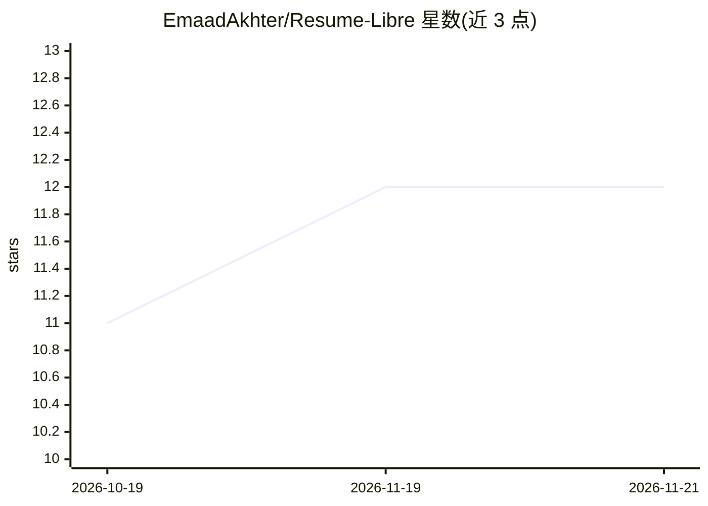

# EmaadAkhter/Resume-Libre

⭐ 12 · Python · AGPL-3.0 · 推送 2026-08-16 · [GitHub](https://github.com/EmaadAkhter/Resume-Libre) · [官网](https://resumelibre.com) · 个人维护

**面向求职者的 AI 简历生成器：输入 GitHub/LinkedIn 与 JD，产出 LaTeX PDF**

自托管的开源简历生成应用：读取 GitHub 个人资料 README、粘贴或抓取 LinkedIn 文本，结合职位描述经 OpenRouter 调用 LLM 生成完整 LaTeX 文档，由 Tectonic 编译为 PDF 并流式输出到编辑器。内置 31 项确定性 ATS 可解析性检查与「修复并重新生成」回路，支持关键词差距分析、7 职业分步引导向导、5 套 LaTeX 模板、版本回滚、公开分享页。提供 Docker Compose 部署与零配置演示模式，AGPL-3.0 许可。

## 筛选速览

| 维度 | 判定 | 备注 |
|---|---|---|
| AI 角色 | `ai-native` | 本体是模型或模型工具 |
| 许可风险 | `viral` | AGPL-3.0 |
| 部署形态 | `self-host` | docker 或自建部署 |
| 模型依赖 | locked-api |  |
| 硬件要求 | — | 无带数字的原话,不猜 |
| 安装摩擦 | `low` | 无编译、无系统依赖或容器化 |
| 成熟度 | — | 结构信号不足 |

## 能力要点

- GitHub README + LinkedIn + JD 输入，LLM 生成 LaTeX 并由 Tectonic 编译为 PDF
- 31 项确定性 ATS 检查，检查结果回注提示词触发修复重生成
- 演示模式零 API key 运行完整栈（固定 LLM 输出、真实 PDF 编译）
- 简历分支/提交/回滚的版本控制与 /r/<user_id> 公开分享

## 适用场景

- 针对具体职位描述定制生成一页 LaTeX 简历 PDF
- 上传现有 PDF/DOCX 简历做 ATS 可解析性体检与关键词差距分析
- 自托管部署为团队或个人的私有简历生成服务

## 场景标签

`AI 写作` · 领域:内容生成

## 证据(README 行号)

> L11: Resume-Libre reads your **GitHub profile README**, takes your **LinkedIn profile** (paste the text, or let the serv
> L13: Every compiled PDF is automatically run through the built-in **ATS parseability checker** — 31 deterministic checks

## 星数曲线

2026-10-19 11 → 2026-11-21 12（+1）

---
*卡片 v1 · prompt 1.4 · 生成 2026-11-19 · 置信度 high · 依据 README sha `b0e30de00e39` · [字段定义](../../DATASET.md)*
