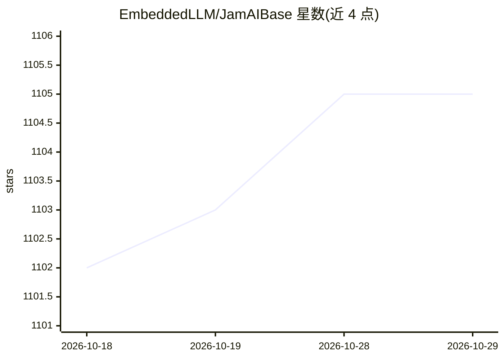

# EmbeddedLLM/JamAIBase

⭐ 1,105 · Python · Apache-2.0 · 推送 2026-10-22 · [GitHub](https://github.com/EmbeddedLLM/JamAIBase) · [官网](https://www.jamaibase.com/) · 组织维护

**开源 RAG 后端平台：电子表格式 UI 构建与管理 LLM 应用**

JamAI Base 是开源 RAG 后端平台，内嵌 SQLite 数据库与 LanceDB 向量数据库，内置 LLM、向量嵌入与重排器编排。提供 Generative/Action/Knowledge/Chat 四类表格抽象，以电子表格式 UI 与 REST API 管理数据生成、聊天机器人和 RAG 流水线；支持查询重写、混合搜索与自适应分块。可使用官方云服务免费注册，或按指南自部署；采用 Apache 2.0 许可证，由 EmbeddedLLM 维护。

## 筛选速览

| 维度 | 判定 | 备注 |
|---|---|---|
| AI 角色 | `ai-ecosystem` | LLM/agent 周边工具 |
| 许可风险 | `permissive` | Apache-2.0 |
| 部署形态 | `None` |  |
| 模型依赖 | — | README 未给出锁定关系 |
| 硬件要求 | — | 无带数字的原话,不猜 |
| 安装摩擦 | `low` | 无编译、无系统依赖或容器化 |
| 成熟度 | — | 结构信号不足 |

## 能力要点

- 内嵌 SQLite 与 LanceDB 向量数据库，内置 RAG 与记忆管理
- Generative/Action/Knowledge/Chat 四类表格抽象
- 混合搜索（关键词/结构化/向量）与重排、自适应分块
- 支持任意 LLM（OpenAI GPT-4、Anthropic Claude 3、Meta Llama3）

## 适用场景

- 不写后端代码即可构建带 RAG 的聊天机器人
- 在电子表格式界面中做 LLM 提示词与数据生成实验
- 管理结构化知识与文档并供生成表格检索使用

## 场景标签

`RAG` `聊天机器人` · 领域:对话与助手

## 证据(README 行号)

> L13: JamAI Base is an open-source RAG (Retrieval-Augmented Generation) backend platform that integrates an embedded data
> L25: - Built-in LLM, vector embeddings, and reranker orchestration
> L27: - Simple REST API

## 星数曲线

2026-10-18 1,102 → 2026-10-29 1,105（+3）

---
*卡片 v1 · prompt 1.4 · 生成 2026-10-21 · 置信度 high · 依据 README sha `165acf9b21d3` · [字段定义](../../DATASET.md)*
