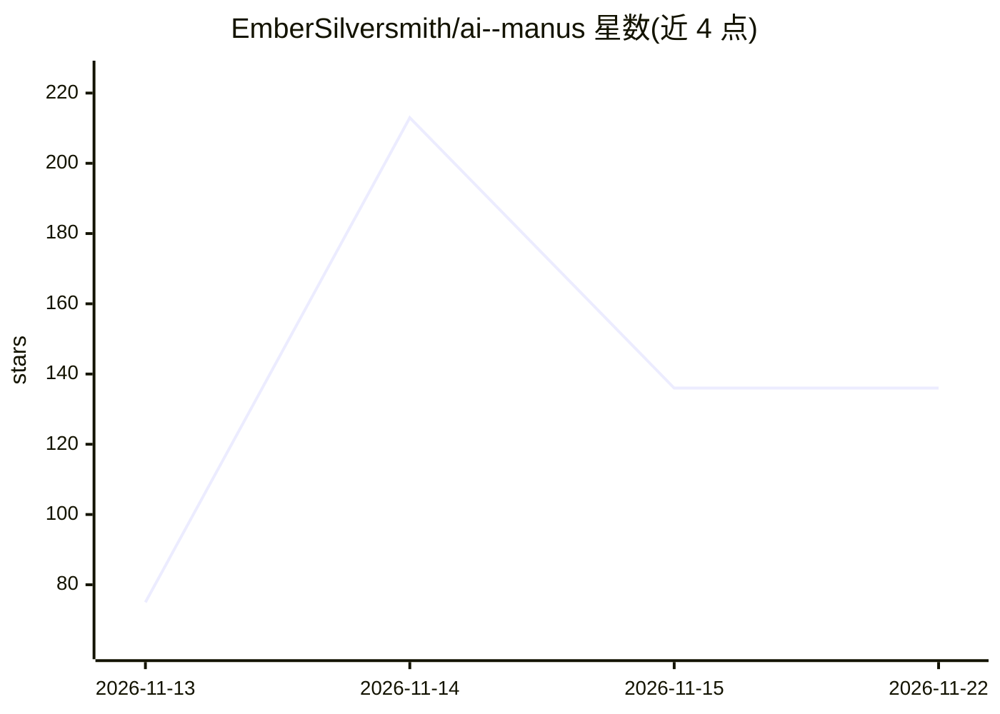

# EmberSilversmith/ai--manus

⭐ 136 · Apache-2.0 · 推送 2026-11-15 · [GitHub](https://github.com/EmberSilversmith/ai--manus) · 个人维护

**面向个人用户的自主 AI Agent：代跑代码与操作浏览器**

README 描述 Manus 为可在用户侧自主执行代码并控制浏览器的通用 AI Agent，面向家庭、学习与轻量办公场景，多步骤任务以低监督方式完成。代码执行与浏览器操作可在同一流程内衔接，并声明跨会话保持一致的任务模式。README 为介绍性文案：给出硬件兼容表（4GB 内存起步、推荐 8GB）与使用步骤，但未提供任何安装命令、运行方式、模型接入或代码实现的可验证细节，页面顶部出现下载链接与促销代码字样。

## 筛选速览

| 维度 | 判定 | 备注 |
|---|---|---|
| AI 角色 | `ai-native` | 本体是模型或模型工具 |
| 许可风险 | `permissive` | Apache-2.0 |
| 部署形态 | `None` |  |
| 模型依赖 | — | README 未给出锁定关系 |
| 硬件要求 | — | 无带数字的原话,不猜 |
| 安装摩擦 | `low` | 无编译、无系统依赖或容器化 |
| 成熟度 | — | 结构信号不足 |

## 能力要点

- 自主执行代码与控制浏览器，支持多步骤任务
- 代码与浏览器操作在同一流程内衔接
- 给出硬件兼容表：双核 CPU、4GB 内存起步、推荐 8GB

## 适用场景

- 让 Agent 代为收集网页资料、填写表单
- 自动运行小脚本并整理研究结果
- 处理日常重复性小任务以减少手动操作

## 场景标签

`浏览器自动化` `AI 助手` · 领域:效率与自动化

## 证据(README 行号)

> L10: - **Autonomous Code Execution:** Manus AI agent runs code on its own to complete tasks, so you can focus on decisio
> L18: Manus is an autonomous AI agent designed to run code and control a browser on your behalf. Instead of acting like a

## 星数曲线

2026-11-13 75 → 2026-11-22 136（+61）

---
*卡片 v1 · prompt 1.4 · 生成 2026-11-17 · 置信度 low · 依据 README sha `0f78ee3a5dd2` · [字段定义](../../DATASET.md)*
