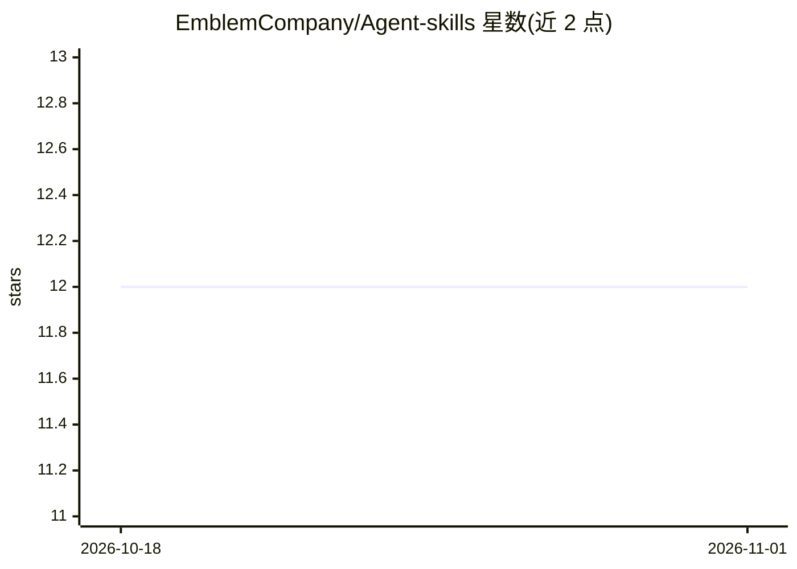

# EmblemCompany/Agent-skills

⭐ 12 · Shell · MIT · 推送 2026-05-15 · [GitHub](https://github.com/EmblemCompany/Agent-skills) · [官网](https://emblemvault.ai) · 组织维护

**面向 AI agent 的 EmblemAI 加密技能集合（7 链 200+ 工具）**

EmblemAI 官方维护的 Agent Skills 技能仓库：提供 emblem-ai 核心技能、React 集成、agent 钱包与提示词示例等技能，覆盖 7 条区块链（Solana、Ethereum、Base、BSC、Polygon、Hedera、Bitcoin）上的兑换、DeFi、NFT、跨链桥操作。技能遵循 agentskills.io 规范的 SKILL.md 格式，通过 npx skills add 安装；运行时调用工具需另行安装托管 MCP 服务器（支持 Claude Code OAuth/API key、GitHub Copilot、Cursor 等）。仓库含共享引用源同步与 CI 验证脚本。

## 筛选速览

| 维度 | 判定 | 备注 |
|---|---|---|
| AI 角色 | `ai-knowledge` | 知识聚合/清单类 |
| 许可风险 | `permissive` | MIT |
| 部署形态 | `library` | 以包/库形式分发 |
| 模型依赖 | locked-api |  |
| 硬件要求 | — | 无带数字的原话,不猜 |
| 安装摩擦 | `low` | 无编译、无系统依赖或容器化 |
| 成熟度 | — | 结构信号不足 |

## 能力要点

- 技能遵循公开 Agent Skills 规范，可跨兼容工具移植
- 通过 npx skills add 按技能安装，另有托管 MCP 服务器接入方式
- 支持 MCP 与 A2A 协议，提供 x402 按调用付费通道
- validate-all.sh 包装官方校验器并在 CI 中运行

## 适用场景

- 给 Claude Code/Cursor 等 agent 添加跨链加密操作技能
- 为应用集成带钱包的用户体系与登录方式
- 构建执行兑换、DeFi、NFT 操作的加密 agent

## 场景标签

 · 领域:区块链/加密货币 agent 工具

## 证据(README 行号)

> L9: Official skill collection for AI agents building with EmblemAI. EmblemAI is open-source crypto infrastructure for bo
> L88: Each skill follows the Agent Skills specification:
> L41: The skills above are authoring guidance. If you want your agent to actually call EmblemAI tools at runtime, install

## 星数曲线

2026-10-18 12 → 2026-11-01 12（+0）

---
*卡片 v1 · prompt 1.4 · 生成 2026-11-01 · 置信度 mid · 依据 README sha `86f9cc44ce50` · [字段定义](../../DATASET.md)*
