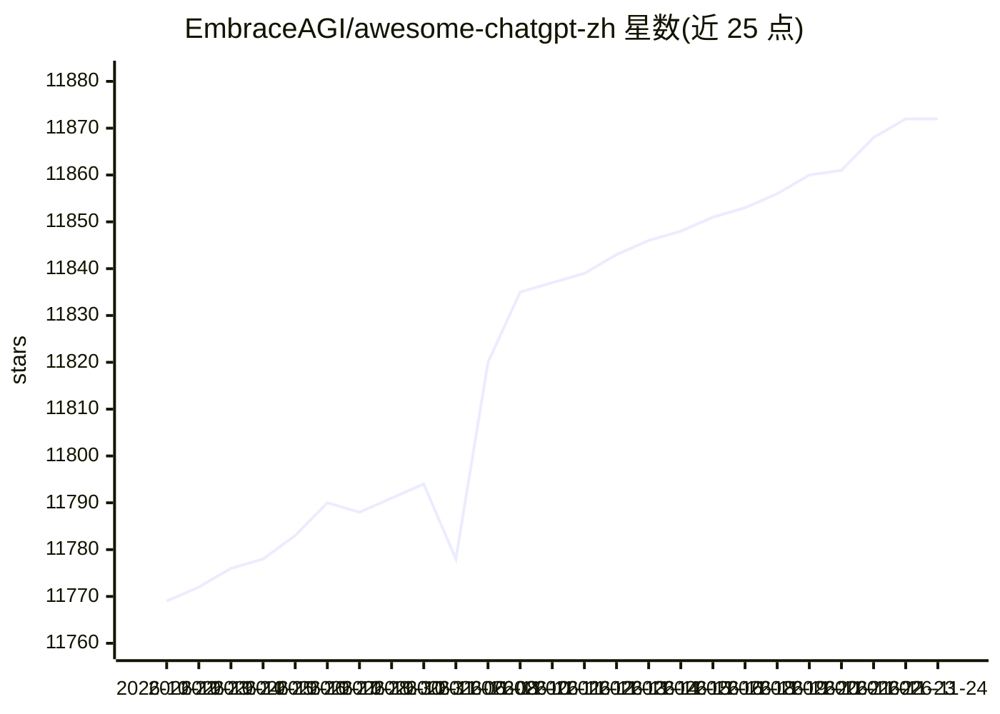

# EmbraceAGI/awesome-chatgpt-zh

⭐ 11,872 · Python · MIT · 推送 2026-11-22 · [GitHub](https://github.com/EmbraceAGI/awesome-chatgpt-zh) · [官网](https://embraceagi.github.io/awesome-chatgpt-zh/) · 组织维护 · 中文 README

**中文用户的 ChatGPT 与前沿 AI 中文资源清单**

面向中文用户的 AI 资源聚合清单：收录 ChatGPT 使用途径、Prompt 工程指南、GPTs 指南、应用开发指南与精选开源项目，并持续扩展到前沿大模型、Claude Skills、MCP 协议、编程智能体、API 代理与模型路由、浏览器自动化、RAG 与生图等专题。由 GitHub Actions 每日抓取 GitHub Trending 自动收录 AI 热门项目，另提供网站版（专题导航、全文搜索）。内容以链接目录为主，无安装运行要求。

## 筛选速览

| 维度 | 判定 | 备注 |
|---|---|---|
| AI 角色 | `ai-knowledge` | 知识聚合/清单类 |
| 许可风险 | `permissive` | MIT |
| 部署形态 | `None` |  |
| 模型依赖 | — | README 未给出锁定关系 |
| 硬件要求 | — | 无带数字的原话,不猜 |
| 安装摩擦 | `low` | 无编译、无系统依赖或容器化 |
| 成熟度 | — | 结构信号不足 |

## 能力要点

- 多专题中文资源目录：Prompt 工程、应用开发、MCP、Claude Skills、编程智能体等
- GitHub Actions 每日自动抓取 Trending 并分类 AI 项目
- 提供网站版：专题导航、全文搜索、Star 排序
- 提供 GitLab 镜像方便国内访问

## 适用场景

- 查找 ChatGPT 及大模型的中文教程与调教指南
- 按专题浏览 MCP、Agent、编程智能体等生态的精选项目
- 了解国内可访问的 AI 生产力工具与资源

## 场景标签

`精选清单` · 领域:学习与行业

## 证据(README 行号)

> L16: ChatGPT 中文指南项目旨在帮助中文用户了解和使用 ChatGPT 及前沿 AI 技术。我们收集了各种免费和付费的 ChatGPT 资源、高效使用中文与大模型交流的方法、应用开发的相关资源，以及基于大模型能力的生产力工具。项目
> L50: 由 GitHub Actions 每天抓取 GitHub Trending（日榜 / 周榜，多语言）与近 30 天新晋高星仓库，按关键词筛选出 AI 相关项目并自动分类（编程智能体、MCP / Skills、API 网关、图像视频

## 星数曲线

2026-10-22 11,769 → 2026-11-24 11,872（+103）

---
*卡片 v1 · prompt 1.4 · 生成 2026-11-22 · 置信度 high · 依据 README sha `42c126aadaea` · [字段定义](../../DATASET.md)*
