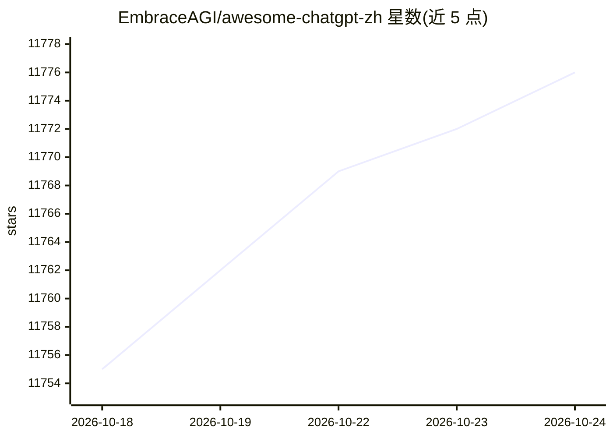

# EmbraceAGI/awesome-chatgpt-zh

⭐ 11,776 · Python · MIT · 推送 2026-10-15 · [GitHub](https://github.com/EmbraceAGI/awesome-chatgpt-zh) · 个人维护 · 中文 README

**中文用户的 ChatGPT 与前沿 AI 资源精选清单**

面向中文用户的 ChatGPT 及大模型资源聚合项目：收录免费/付费 ChatGPT 使用途径、Prompt 工程指南、应用开发指南、生产力工具，并持续跟进 GPT-5、Claude、DeepSeek、MCP、Claude Skills、编程智能体、浏览器自动化、RAG 等主题。组织形式为分类目录加资源链接，附微信公众号与 Telegram 交流群，通过 GitLab 镜像方便国内访问。内容为文档清单，无安装运行需求。

## 筛选速览

| 维度 | 判定 | 备注 |
|---|---|---|
| AI 角色 | `ai-knowledge` | 知识聚合/清单类 |
| 许可风险 | `permissive` | MIT |
| 部署形态 | `None` |  |
| 模型依赖 | — | README 未给出锁定关系 |
| 硬件要求 | — | 无带数字的原话,不猜 |
| 安装摩擦 | `low` | 无编译、无系统依赖或容器化 |
| 成熟度 | — | 结构信号不足 |

## 能力要点

- 覆盖 Prompt 工程、应用开发、大模型技术文章等主题的中文资源目录
- 收录 DeepSeek 生态、Claude Skills、MCP、编程智能体等专题指南
- 提供 GitLab 国内镜像与微信/Telegram 交流社区

## 适用场景

- 查找 ChatGPT 的中文使用途径与高效对话方法
- 按主题检索 MCP、Claude Skills、编程智能体等前沿 AI 资源
- 了解面向中文用户的大模型应用开发资料

## 场景标签

`精选清单` · 领域:学习与行业

## 证据(README 行号)

> L11: ChatGPT 中文指南项目旨在帮助中文用户了解和使用 ChatGPT 及前沿 AI 技术。我们收集了各种免费和付费的 ChatGPT 资源、高效使用中文与大模型交流的方法、应用开发的相关资源，以及基于大模型能力的生产力工具。项目
> L15: ## 什么是 ChatGPT ?

## 星数曲线

2026-10-18 11,755 → 2026-10-24 11,776（+21）

---
*卡片 v1 · prompt 1.4 · 生成 2026-10-20 · 置信度 high · 依据 README sha `e5f6c2968fae` · [字段定义](../../DATASET.md)*
