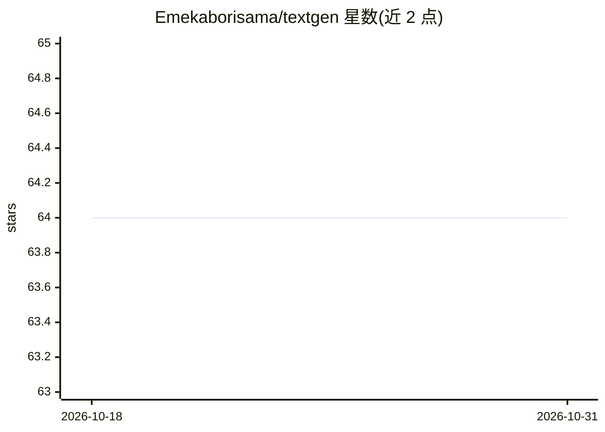

# Emekaborisama/textgen

⭐ 64 · Jupyter Notebook · 推送 2026-02-03 · [GitHub](https://github.com/Emekaborisama/textgen) · 个人维护

**Python 文本生成库：用 LSTM 训练自定义文本生成模型**

基于 TensorFlow 的 Python 库，提供从文本数据加载、LSTM 序列建模、训练到生成文本的完整流水线：loaddata 读取文本格式数据，tentext 管道支持 padding、配置 LSTM 层/激活函数/dropout、categorical_crossentropy 训练，predict 以短语为种子生成指定词数文本。附带超参数优化、损失/准确率可视化、模型保存与加载预测。README 声明 PyTorch 后端与 transformer 模型尚未提供（coming soon），当前仅 TensorFlow 实现。

## 筛选速览

| 维度 | 判定 | 备注 |
|---|---|---|
| AI 角色 | `ai-native` | 本体是模型或模型工具 |
| 许可风险 | `none` | — |
| 部署形态 | `library` | 以包/库形式分发 |
| 模型依赖 | — | README 未给出锁定关系 |
| 硬件要求 | — | 无带数字的原话,不猜 |
| 安装摩擦 | `low` | 无编译、无系统依赖或容器化 |
| 成熟度 | — | 结构信号不足 |

## 能力要点

- loaddata→建模→训练→predict 的端到端文本生成管道
- 支持超参数优化寻找最佳 optimizer/activation
- 模型保存为 .h5 并可加载做预测
- 当前为 TensorFlow 实现，PyTorch 后端标注为即将提供

## 适用场景

- 用自己的文本语料训练并生成文本
- 实验不同 LSTM 结构与超参数配置
- 保存训练好的模型供后续预测复用

## 场景标签

`AI 写作` · 领域:内容生成

## 证据(README 行号)

> L14: Text gen is a python library that allow you build a custom text generation model with ease :smile:
> L15:  Something sweet built with Tensorflow and Pytorch(coming soon) - This is the brain of Rosalove ai (https://rosalov
> L52: pipeline.predict('hello love', word_length = 200, segment = True)

## 星数曲线

2026-10-18 64 → 2026-10-31 64（+0）

---
*卡片 v1 · prompt 1.4 · 生成 2026-10-24 · 置信度 high · 依据 README sha `c4b0b9b5945c` · [字段定义](../../DATASET.md)*
