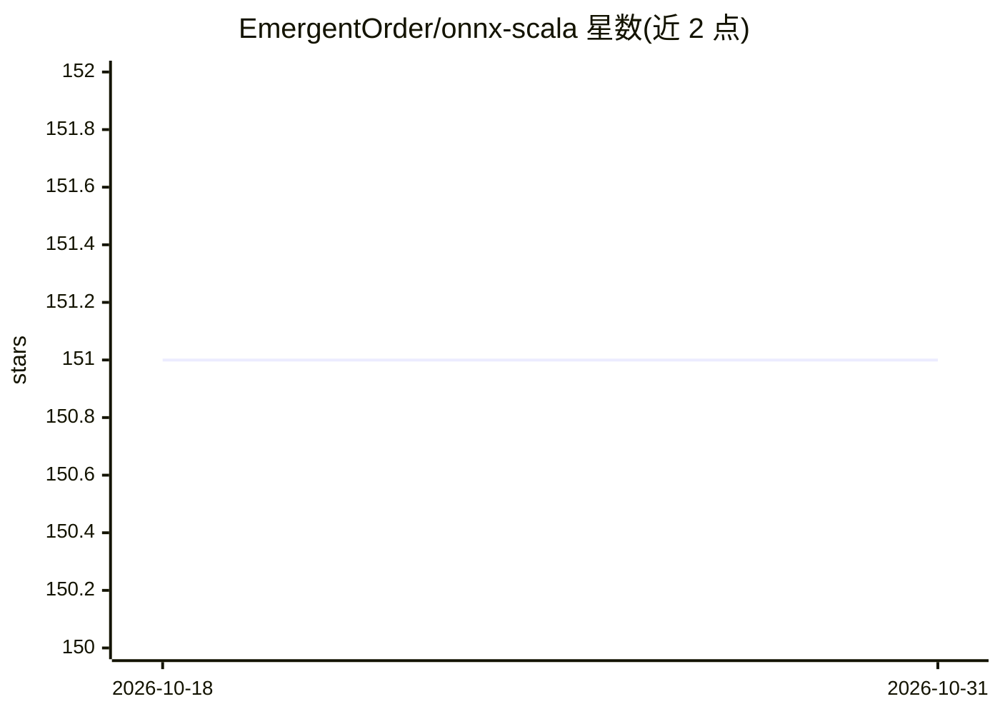

# EmergentOrder/onnx-scala

⭐ 151 · Scala · AGPL-3.0 · 推送 2026-09-29 · [GitHub](https://github.com/EmergentOrder/onnx-scala) · 个人维护

**Scala 3 的 ONNX API 与推理后端库**

为 Scala 3 提供 ONNX 模型推理能力：包含加载完整 ONNX 模型文件直接执行的全模型 API，以及基于 Protobuf 定义与算子 schema 派生的类型安全细粒度 API，支持类型级张量/轴标签与维度字面量。跨构建于 Scala JVM、Scala.js 与 Scala Native 三平台，JVM 后端基于 ONNX Runtime 官方 Java API，JS 后端基于 ONNX Runtime Web。细粒度 API 支持 87/178 个算子，训练（自动微分）尚在考虑中。

## 筛选速览

| 维度 | 判定 | 备注 |
|---|---|---|
| AI 角色 | `ai-ecosystem` | LLM/agent 周边工具 |
| 许可风险 | `viral` | AGPL-3.0 |
| 部署形态 | `None` |  |
| 模型依赖 | — | README 未给出锁定关系 |
| 硬件要求 | — | 无带数字的原话,不猜 |
| 安装摩擦 | `low` | 无编译、无系统依赖或容器化 |
| 成熟度 | — | 结构信号不足 |

## 能力要点

- 全模型 API 加载 ONNX 模型文件并优化整图执行
- 类型级张量/轴标签与维度字面量的类型安全 API
- 跨 Scala JVM / Scala.js / Scala Native 三平台构建
- JVM 后端基于 ONNX Runtime 官方 Java API

## 适用场景

- 在 Scala 项目中加载并运行 ONNX 深度学习模型推理
- 以类型安全方式在编译期约束张量形状与数据类型
- 在 Scala.js 环境中通过 ONNX Runtime Web 运行模型

## 场景标签

`推理引擎` · 领域:训练与推理

## 证据(README 行号)

> L77: For the JVM the backend is based on ONNX Runtime, via their official Java API.

## 星数曲线

2026-10-18 151 → 2026-10-31 151（+0）

---
*卡片 v1 · prompt 1.4 · 生成 2026-10-22 · 置信度 high · 依据 README sha `45c93f1f221e` · [字段定义](../../DATASET.md)*
