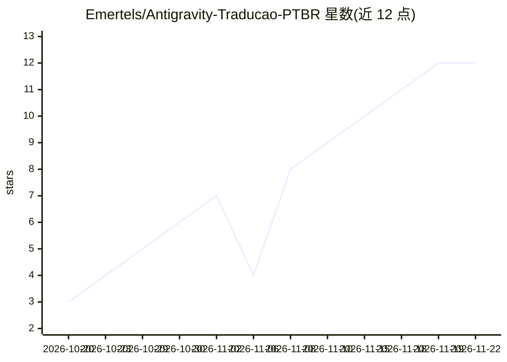

# Emertels/Antigravity-Traducao-PTBR

⭐ 12 · JavaScript · MIT · 推送 2026-11-03 · [GitHub](https://github.com/Emertels/Antigravity-Traducao-PTBR) · [官网](https://www.youtube.com/watch?v=jZhrmjrK5p4) · 个人维护

**巴西葡萄牙语用户：Google Antigravity Desktop 的本地化补丁包**

面向 Google Antigravity Desktop（Electron 应用）的 PT-BR 便携本地化包：以预打包 ZIP 分发，含安装/恢复批处理脚本、便携 Node.js 运行时与生物分子查看器组件。通过动态 Patcher 替换核心 `app.asar` 与 `web-bundle`，覆盖聊天、权限对话框、设置、系统托盘、Agent 命令等界面文本；安装前做版本结构预检，不匹配即阻断并保留原始备份，可用脚本一键还原出厂版本。仅针对特定版本（如 2.23.0/2.28.2），未来版本结构变化会被阻止更新。

## 筛选速览

| 维度 | 判定 | 备注 |
|---|---|---|
| AI 角色 | `ai-knowledge` | 知识聚合/清单类 |
| 许可风险 | `permissive` | MIT |
| 部署形态 | `desktop` | 安装包/桌面程序 |
| 模型依赖 | — | README 未给出锁定关系 |
| 硬件要求 | — | 无带数字的原话,不猜 |
| 安装摩擦 | `low` | 无编译、无系统依赖或容器化 |
| 成熟度 | — | 结构信号不足 |

## 能力要点

- 两个批处理脚本完成应用与还原：Instalar-Traducao.bat / Restaurar-Original.bat
- 安装前结构预检，版本不匹配自动阻断，含模块化原始备份
- 便携 ZIP 内置 Windows x64 Node.js 24.21.0，无需额外安装或联网
- DOM 翻译器分帧处理动态文本，排除 Lexical/Slate/Monaco 编辑器组件

## 适用场景

- 把 Antigravity 的界面和对话面板切换为巴西葡萄牙语
- 升级 Antigravity 后需要回退到原厂界面
- 在离线环境下从 U 盘或外部硬盘安装语言包

## 场景标签

 · 领域:软件本地化/AI 开发工具周边

## 证据(README 行号)

> L21: Pacote portátil de localização PT-BR do **Google Antigravity Desktop** para Português do Brasil (pt-BR). Tradução p
> L74: ## 🎯 O que Foi Traduzido

## 星数曲线

2026-10-20 3 → 2026-11-22 12（+9）

---
*卡片 v1 · prompt 1.4 · 生成 2026-11-19 · 置信度 mid · 依据 README sha `d78014da8b5a` · [字段定义](../../DATASET.md)*
