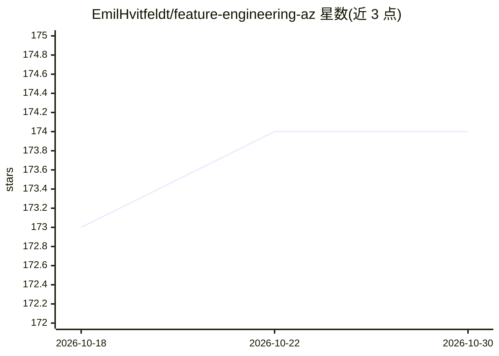

# EmilHvitfeldt/feature-engineering-az

⭐ 174 · HTML · 推送 2026-08-17 · [GitHub](https://github.com/EmilHvitfeldt/feature-engineering-az) · [官网](https://feaz-book.com/) · 个人维护

**《Feature Engineering A-Z》图书源码仓库，附 AI 技能**

图书《Feature Engineering A-Z》的源材料仓库，渲染版发布于 feaz-book.com。内容同时提供 R 与 Python 示例，用 renv 管理 R 依赖、uv 管理 Python 依赖，经 Quarto 渲染成书。另附自定义 AI 技能（Ask FEAZ、Workflow Builder），供用户的 AI agent 查询书中特征工程方法、设计特征工程流水线。书中文字与代码为手写，AI 工具仅用于文字校对与生成 AI 技能。

## 筛选速览

| 维度 | 判定 | 备注 |
|---|---|---|
| AI 角色 | `ai-knowledge` | 知识聚合/清单类 |
| 许可风险 | `none` | — |
| 部署形态 | `None` |  |
| 模型依赖 | — | README 未给出锁定关系 |
| 硬件要求 | — | 无带数字的原话,不猜 |
| 安装摩擦 | `low` | 无编译、无系统依赖或容器化 |
| 成熟度 | — | 结构信号不足 |

## 能力要点

- R 与 Python 双语言示例（renv/uv 管理依赖）
- Quarto 渲染的在线图书
- 附 Ask FEAZ 与 Workflow Builder 两个 AI agent 技能

## 适用场景

- 学习特征工程方法并对照 R/Python 实现
- 让 AI agent 基于本书内容回答特征工程问题
- 为数据集设计特征工程流水线

## 场景标签

`教程课程` · 领域:学习与行业

## 证据(README 行号)

> L3: This repository contains the source material for the book "Feature Engineering A-Z". The rendered book can be found 
> L15: I'm going to try something new,

## 星数曲线

2026-10-18 173 → 2026-10-30 174（+1）

---
*卡片 v1 · prompt 1.4 · 生成 2026-10-22 · 置信度 high · 依据 README sha `0be8eae8e489` · [字段定义](../../DATASET.md)*
