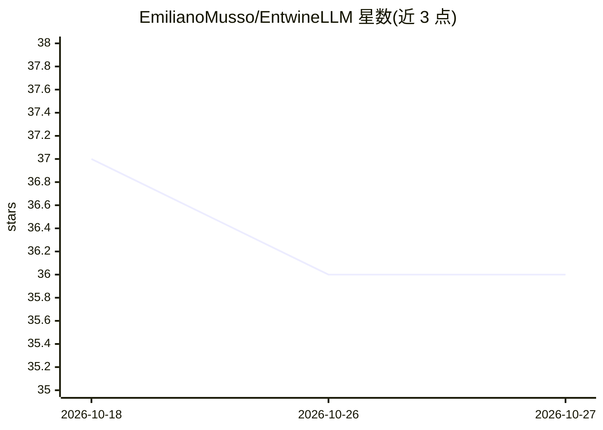

# EmilianoMusso/EntwineLLM

⭐ 36 · C# · MIT · 推送 2025-12-09 · [GitHub](https://github.com/EmilianoMusso/EntwineLLM) · 个人维护

**Visual Studio 本地 LLM 编码助手扩展**

面向 Visual Studio 开发者的免费扩展，通过本地或 Docker 部署的开源 LLM 实现（如 Ollama、LMStudio）提供编码辅助，不依赖第三方 API。功能包括重构代码、生成单元测试、生成文档、代码审查及迭代式 Follow-up 追问；结果可覆写原代码或保存为文件。提示词遵循 Clean Code 原则并拒绝非编码请求，支持多语言（C#/Python/Java）。自 v1.13 起支持可选 Bearer 认证令牌，适用于反向代理后的受限 LLM 部署，并附带 docker-compose 与 nginx 示例配置。

## 筛选速览

| 维度 | 判定 | 备注 |
|---|---|---|
| AI 角色 | `ai-native` | 本体是模型或模型工具 |
| 许可风险 | `permissive` | MIT |
| 部署形态 | `None` |  |
| 模型依赖 | local-ok | 支持本地模型 |
| 硬件要求 | — | 无带数字的原话,不猜 |
| 安装摩擦 | `low` | 无编译、无系统依赖或容器化 |
| 成熟度 | — | 结构信号不足 |

## 能力要点

- 调用本地 LLM API 完成重构、单元测试生成、文档生成与代码审查
- Follow-up 字段支持在同一工作流内迭代细化生成结果
- 可选 Bearer 认证令牌，适配反向代理后受限访问的 LLM
- 附 docker-compose 与 nginx 示例，可搭建带认证的本地测试环境

## 适用场景

- 在 Visual Studio 内用本地模型重构或生成代码
- 为选中函数生成覆盖各路径的单元测试
- 在无第三方 API、数据不出本地的环境下获得编码辅助

## 场景标签

`代码生成` `代码审查` · 领域:编码与开发

## 证据(README 行号)

> L3: EntwineLLM is a free Visual Studio extension designed to leverage LLM capabilities to assist developers in writing c
> L34: * Refactor code : Select a block of code or text related to the function you wish to create, and the extension will

## 星数曲线

2026-10-18 37 → 2026-10-27 36（-1）

---
*卡片 v1 · prompt 1.4 · 生成 2026-10-25 · 置信度 high · 依据 README sha `0c4be128a665` · [字段定义](../../DATASET.md)*
