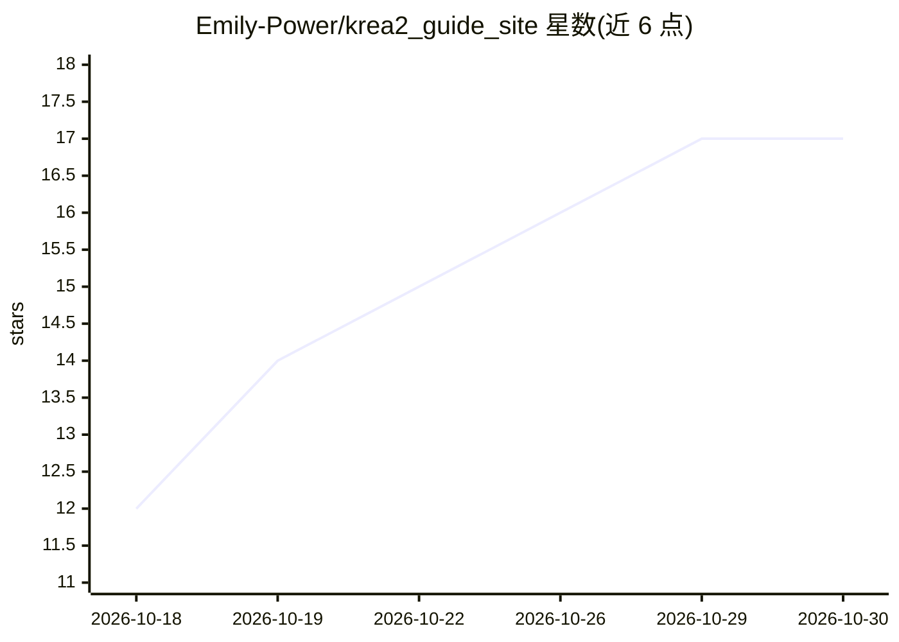

# Emily-Power/krea2_guide_site

⭐ 17 · JavaScript · MIT · 推送 2026-09-19 · [GitHub](https://github.com/Emily-Power/krea2_guide_site) · 个人维护 · 中文 README

**18+ 文生图提示词教学站：三条线提示词的导演台与写法规则**

面向 18 岁以上用户的纯静态教学站点，围绕 figure-photo / youth-seduction / erotic 三个提示词技能（随仓库携带在 skills/ 目录）组织内容：提供表单式导演台按维度点选姿/服/场/光并实时预览与复制英文提示词，配合写法规则、菜单全图、尺度图表与 674 条组合图库映射。组合包 catalog 由构建脚本从 SKILL.md 自动生成。无依赖、静态服务器或 file:// 即可打开；图片资源未随仓库分发，缺图时显示占位图。含露骨文本内容，禁止未成年。

## 筛选速览

| 维度 | 判定 | 备注 |
|---|---|---|
| AI 角色 | `ai-knowledge` | 知识聚合/清单类 |
| 许可风险 | `permissive` | MIT |
| 部署形态 | `None` |  |
| 模型依赖 | — | README 未给出锁定关系 |
| 硬件要求 | — | 无带数字的原话,不猜 |
| 安装摩擦 | `low` | 无编译、无系统依赖或容器化 |
| 成熟度 | — | 结构信号不足 |

## 能力要点

- 三 Skill 路由：Figure 六层 / Youth / Erotic 七层结构，hash 路由切换 Tab
- 导演台 v3 表单式拼装：各 10 套预设、命名组合包点选、实时预览与复制提示词
- 公共维度体系（L1 十二维）+ 专属轴（zone / 暗示 / E0–E4 暴露轴）
- catalog 由脚本从 SKILL.md 自动生成，674 条组合图库映射，缺图有全局兜底占位

## 适用场景

- 学习并拼装三条线（写真/纯欲/成人）文生图提示词
- 按维度点菜快速生成符合目标篇幅的英文提示词
- 对照尺度图表与菜单全图理解提示词写法规则

## 场景标签

`提示工程` `教程课程` · 领域:Agent 开发

## 证据(README 行号)

> L1: # Skill 教学站（krea2_guide_site）
> L3: **figure-photo-prompt** + **youth-seduction-prompt** + **erotic-prompt** 三个提示词技能的
> L91: 组合包 catalog 由 `scripts/build_director_catalog.py` 从 **仓库内 `skills/` 的 SKILL.md**

## 星数曲线

2026-10-18 12 → 2026-10-30 17（+5）

---
*卡片 v1 · prompt 1.4 · 生成 2026-10-30 · 置信度 high · 依据 README sha `60f6befaa81b` · [字段定义](../../DATASET.md)*
