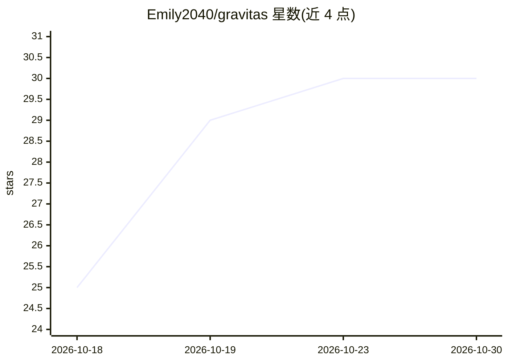

# Emily2040/gravitas

⭐ 30 · Python · MIT · 推送 2026-10-22 · [GitHub](https://github.com/Emily2040/gravitas) · 个人维护 · 中文 README

**Google Antigravity 的免费插件：让 AI agent 核查答案依据并指出错误假设**

面向 Google Antigravity（桌面应用或 agy 命令行工具）的免费附加组件（MIT，v1.2.1）：安装 1 个技能与 8 个 gravitas- 前缀的 agent，使 agent 检查回答所依赖的假设、指出其中错误并仍交付所需结果。安装方式为下载 ZIP 后运行各平台安装脚本（Windows/Mac 双击、Linux 执行 bash 脚本），可选四种界面语言（英/中/日/韩），卸载时文件移入备份目录。作者声明 Mac/Linux 安装器仅在 Windows 下的 bash 中测试过。README 含 Gemini 模型盲评对比示例。

## 筛选速览

| 维度 | 判定 | 备注 |
|---|---|---|
| AI 角色 | `ai-ecosystem` | LLM/agent 周边工具 |
| 许可风险 | `permissive` | MIT |
| 部署形态 | `desktop` | 安装包/桌面程序 |
| 模型依赖 | — | README 未给出锁定关系 |
| 硬件要求 | — | 无带数字的原话,不猜 |
| 安装摩擦 | `low` | 无编译、无系统依赖或容器化 |
| 成熟度 | — | 结构信号不足 |

## 能力要点

- 向 Antigravity 注入 1 个技能与 8 个 agent 以核查回答依据
- Windows/Mac 双击安装，Linux 单行 bash 命令，无需 Python
- 四语言界面菜单（英/中/日/韩），回答语言跟随用户输入
- 卸载时替换/移除的文件全部进入备份目录

## 适用场景

- 让 Antigravity 的 agent 在回答前核对自己依赖的假设
- 希望 agent 指出我的前提有误但仍给出可用结果
- 为 Antigravity 增加事实核查行为而不改动其他配置

## 场景标签

`提示工程` · 领域:Agent 开发

## 证据(README 行号)

> L10: Gravitas is a free add-on for Google Antigravity that makes its AI agent check what your answer depends on, tell yo
> L70: It worked if the answer names one skill, `gravitas`, and eight agents whose names start with `gravitas-`. If it nam
> L76: The installer changes only what belongs to Gravitas: Antigravity's plugin folder, `.gemini/config/plugins/gravitas`

## 星数曲线

2026-10-18 25 → 2026-10-30 30（+5）

---
*卡片 v1 · prompt 1.4 · 生成 2026-10-26 · 置信度 high · 依据 README sha `c1fae308d6a5` · [字段定义](../../DATASET.md)*
