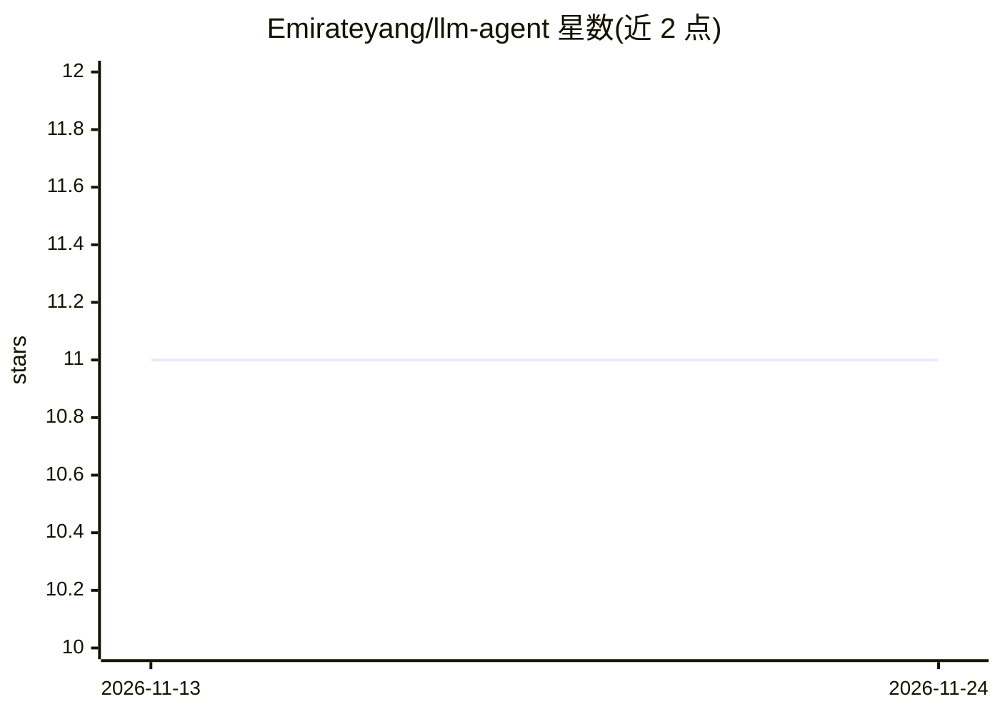

# Emirateyang/llm-agent

⭐ 11 · Java · Apache-2.0 · 推送 2026-03-26 · [GitHub](https://github.com/Emirateyang/llm-agent) · 组织维护

**帮助 Java 开发者集成 LLM 的 Java 库**

一个 Java 库，目标是简化在 Java 应用中接入 LLM 的过程，由公司内部系统开发过程中沉淀而来。README 声明核心能力已可用，可据此开始构建 LLM 驱动的应用，同时注明部分功能仍在开发中；代码示例章节标注为即将提供。具体接口、依赖与安装方式在可见内容中未给出。

## 筛选速览

| 维度 | 判定 | 备注 |
|---|---|---|
| AI 角色 | `ai-ecosystem` | LLM/agent 周边工具 |
| 许可风险 | `permissive` | Apache-2.0 |
| 部署形态 | `None` |  |
| 模型依赖 | — | README 未给出锁定关系 |
| 硬件要求 | — | 无带数字的原话,不猜 |
| 安装摩擦 | `low` | 无编译、无系统依赖或容器化 |
| 成熟度 | `idea` | |

## 能力要点

- 提供简化 LLM 接入的 Java 库
- 源自公司内部系统开发的实际使用
- 主题标签含 azure、dify、mcp、openai、embeddings、vector-database

## 适用场景

- 在 Java 应用中接入 LLM 能力
- 构建 LLM 驱动的企业应用

## 场景标签

 · 领域:LLM 基础设施/开发库

## 证据(README 行号)

> L7: The goal of llm-agent is to simplify integrating LLMs into Java applications.
> L9: This project was started to enable convenient access to LLMs during the development of our company's internal system

## 星数曲线

2026-11-13 11 → 2026-11-24 11（+0）

---
*卡片 v1 · prompt 1.4 · 生成 2026-11-19 · 置信度 mid · 依据 README sha `2089da0f3e64` · [字段定义](../../DATASET.md)*
