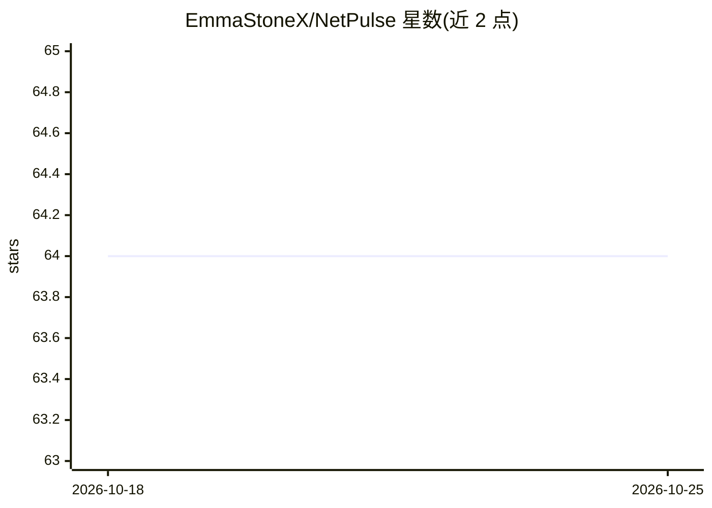

# EmmaStoneX/NetPulse

⭐ 64 · TypeScript · MIT · 推送 2026-03-21 · [GitHub](https://github.com/EmmaStoneX/NetPulse) · [官网](https://netpulse.zxvmax.com) · 个人维护 · 中文 README

**面向用户的互联网事件分析应用：搜索增强生成事件洞察**

基于搜索接地（Tavily API 抓取实时网络上下文）与 Gemini 模型的互联网事件分析器，面向终端用户输出结构化摘要、核心影响分析与历史先例对比（Historical Echoes）。采用 Cloudflare Workers BFF 架构，API 密钥存于服务端 Secrets，支持中英双语界面。提供快速模式（Gemini Flash-Lite，约15秒）与深度模式（Gemini 3.1 Pro，约60秒），高级用户可自定义搜索（Tavily/Exa）与 LLM（DeepSeek/OpenAI/Claude 等）密钥。需自行部署到 Cloudflare，需 Tavily 与 Gemini API Key。

## 筛选速览

| 维度 | 判定 | 备注 |
|---|---|---|
| AI 角色 | `ai-native` | 本体是模型或模型工具 |
| 许可风险 | `permissive` | MIT |
| 部署形态 | `library` | 以包/库形式分发 |
| 模型依赖 | — | README 未给出锁定关系 |
| 硬件要求 | — | 无带数字的原话,不猜 |
| 安装摩擦 | `low` | 无编译、无系统依赖或容器化 |
| 成熟度 | — | 结构信号不足 |

## 能力要点

- 搜索接地分析：Tavily 抓取实时上下文后由 Gemini 生成结构化事件洞察
- 双分析模式：快速（Flash-Lite 约15秒）与深度（Gemini 3.1 Pro 约60秒）
- Historical Echoes：将当前事件与历史先例对比寻找模式
- 支持最多 10 个 Tavily Key 轮询负载均衡与自定义 LLM 端点

## 适用场景

- 输入科技/互联网事件话题，获得带来源上下文的摘要与影响分析
- 对比当前事件与历史先例，寻找事件模式
- 自部署到 Cloudflare 后分享分析短链给他人

## 场景标签

 · 领域:互联网事件分析/Web 应用

## 证据(README 行号)

> L7: **NetPulse** is an intelligent internet event analyzer powered by search grounding. It transforms scattered web info
> L18:  - **Quick Mode** (~15s): Fast scanning with Gemini Flash-Lite

## 星数曲线

2026-10-18 64 → 2026-10-25 64（+0）

---
*卡片 v1 · prompt 1.4 · 生成 2026-10-24 · 置信度 high · 依据 README sha `34c33492ba3c` · [字段定义](../../DATASET.md)*
