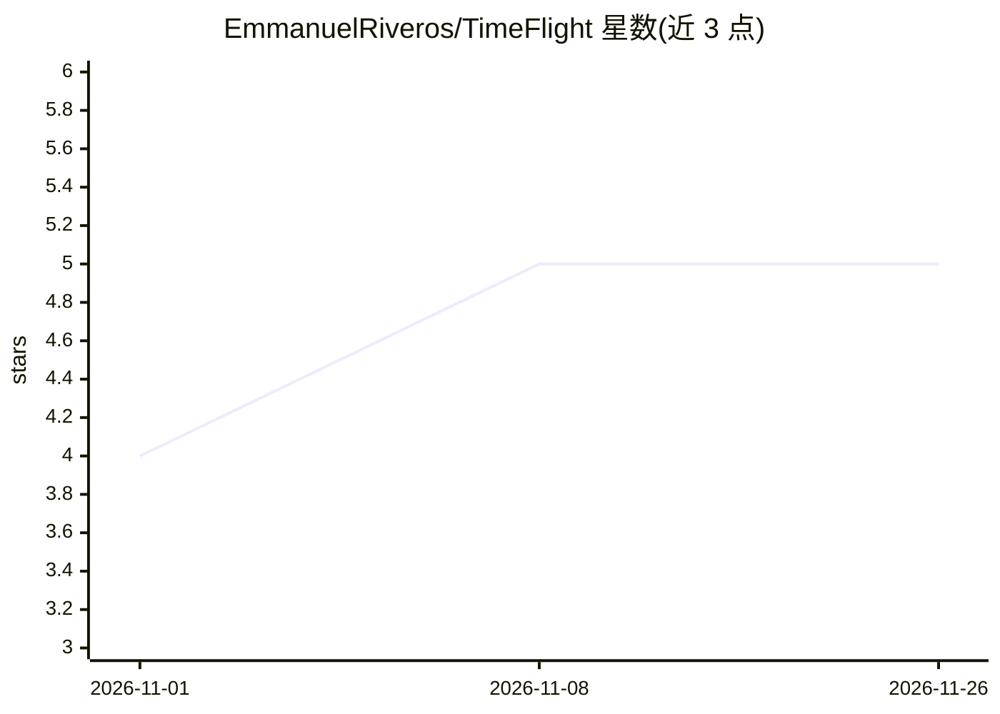

# EmmanuelRiveros/TimeFlight

⭐ 5 · Python · Apache-2.0 · 推送 2026-10-28 · [GitHub](https://github.com/EmmanuelRiveros/TimeFlight) · 个人维护

**无人机视角历史时空回溯视频生成管线（ComfyUI）**

一个 ComfyUI 视频生成管线：沿真实经纬度相机路径，用 Blender 从 Copernicus GLO-30 与 OpenStreetMap 构建当前场景并渲染 16-bit 深度；时代清单替换为带来源与置信度标注的历史代理几何；深度经 IC-LoRA 直接引导 LTX-2.5 生成过去与现在两段视频，再按世界区域合并并用逐像素时间波合成。提供 5 个 ComfyUI 节点、纯 Python 核心包、Colab 与本地 GPU 脚本；生成需 A100 80GB 级 GPU 与 LTX 门控模型授权，作者声明输出是示意性 AI 重构而非历史记录。

## 筛选速览

| 维度 | 判定 | 备注 |
|---|---|---|
| AI 角色 | `ai-native` | 本体是模型或模型工具 |
| 许可风险 | `permissive` | Apache-2.0 |
| 部署形态 | `library` | 以包/库形式分发 |
| 模型依赖 | — | README 未给出锁定关系 |
| 硬件要求 | — | 无带数字的原话,不猜 |
| 安装摩擦 | `medium` | 含编译或系统依赖之一 |
| 成熟度 | — | 结构信号不足 |

## 能力要点

- 深度直接引导 LTX-2.5 生成，不经过深度估计器
- 时代几何每个元素引用来源、许可与置信度等级
- 许可未核验时节点拒绝最终渲染，资产日志自动生成致谢
- 提供 Colab 笔记本与本地 GPU 两套运行路径

## 适用场景

- 将现代城市视频回溯到指定历史年代的形态
- 基于开放地理数据做历史场景示意性重建
- 为 ComfyUI 用户提供带来源追溯的深度引导视频工作流

## 场景标签

`视频生成` · 领域:内容生成

## 证据(README 行号)

> L8: TimeFlight is a ComfyUI pipeline built from open geodata, period geometry with cited sources,
> L43: 4. **Depth-guided generation.** The Blender depth, encoded as inverse depth, is fed straight into
> L61: Everything runs as one ComfyUI API graph driven through the Comfy SDK (`comfy-sdk` → `comfy-api-proxy`

## 星数曲线

2026-11-01 4 → 2026-11-26 5（+1）

---
*卡片 v1 · prompt 1.4 · 生成 2026-11-22 · 置信度 high · 依据 README sha `d5ed463bcd65` · [字段定义](../../DATASET.md)*
