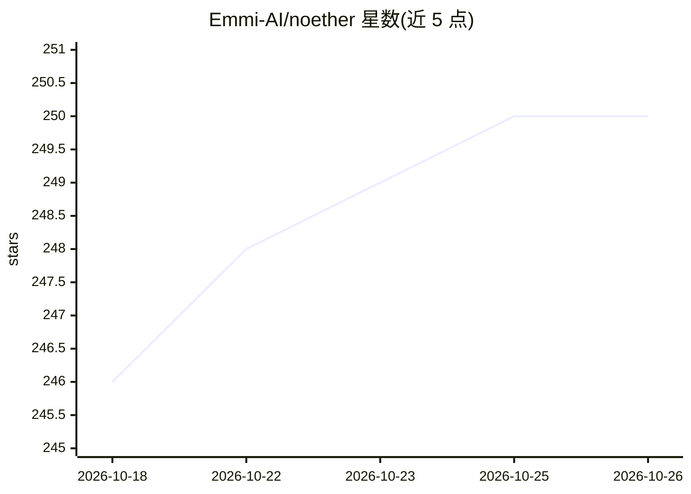

# Emmi-AI/noether

⭐ 250 · Python · NOASSERTION · 推送 2026-10-07 · [GitHub](https://github.com/Emmi-AI/noether) · [官网](https://emmi.ai/noether-framework) · 组织维护

**面向工程仿真的 Transformer 深度学习框架：构建、训练与运行工业仿真模型**

Emmi AI 开源的 PyTorch 框架，基于面向物理系统优化的 Transformer 构件，覆盖工业仿真模型的构建、训练与部署全流程。支持 CPU、Apple Silicon MPS、NVIDIA GPU 以及多 GPU 与 SLURM 集群；提供 uv/pip 安装、项目脚手架（noether-init/noether-train）与端到端 recipe（外空气动力学、流体传热等）。支持 macOS 与 Linux，Windows 无官方支持。许可证为 ENPL（基于 Mistral MNPL）：研发可用，生产/商业部署需另行购买商业许可。

## 筛选速览

| 维度 | 判定 | 备注 |
|---|---|---|
| AI 角色 | `ai-native` | 本体是模型或模型工具 |
| 许可风险 | `none` | NOASSERTION |
| 部署形态 | `library` | 以包/库形式分发 |
| 模型依赖 | — | README 未给出锁定关系 |
| 硬件要求 | — | 无带数字的原话,不猜 |
| 安装摩擦 | `medium` | 含编译或系统依赖之一 |
| 成熟度 | — | 结构信号不足 |

## 能力要点

- 面向物理系统的模块化 Transformer 构件
- 跨 CPU / Apple Silicon MPS / NVIDIA GPU 运行，支持多 GPU 与 SLURM 集群
- uv/pip 安装 + noether-init 项目脚手架 + noether-train 训练 CLI
- 提供 AB-UPT、外空气动力学、流体传热等端到端训练 recipe

## 适用场景

- 训练 CFD/传热等工程仿真的神经代理模型
- 在 CPU、Apple Silicon 或 GPU 集群上运行工程仿真训练
- 以脚手架快速搭建工程 AI 训练项目

## 场景标签

`模型训练` · 领域:训练与推理

## 证据(README 行号)

> L12:  Noether is Emmi AI’s open software framework for Engineering AI . Built on
> L13:  transformer building blocks , it delivers the full engineering stack, allowing teams to build,
> L14: train, and operate industrial simulation models across engineering verticals, eliminating the need for component

## 星数曲线

2026-10-18 246 → 2026-10-26 250（+4）

---
*卡片 v1 · prompt 1.4 · 生成 2026-10-22 · 置信度 high · 依据 README sha `60a131e94789` · [字段定义](../../DATASET.md)*
