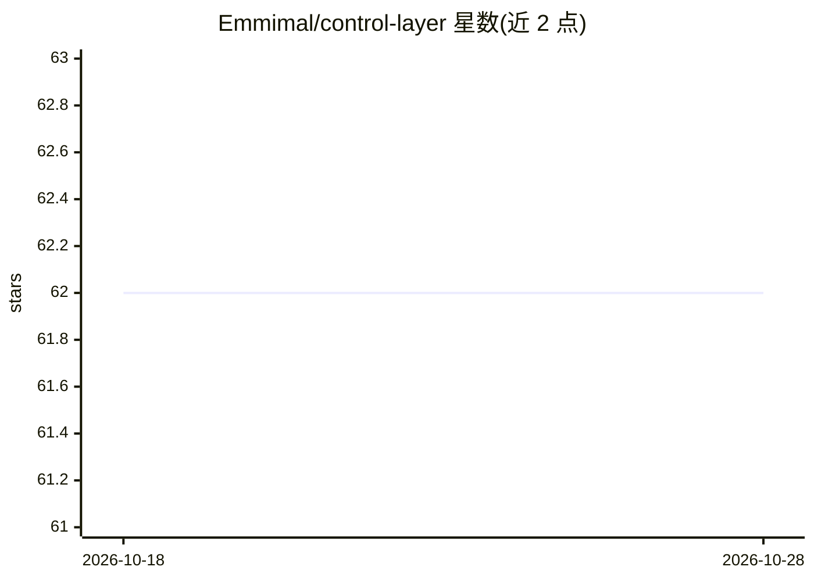

# Emmimal/control-layer

⭐ 62 · Python · MIT · 推送 2026-05-25 · [GitHub](https://github.com/Emmimal/control-layer) · 个人维护

**LLM 调用治理库：输入校验、模式强制、熔断重试与审计一体化**

嵌入应用逻辑与任意 LLM 之间的 Python 控制层，由八个可组合组件构成流水线：InputGuard 做 20 模式注入检测与长度校验、TokenBudget 按 tiktoken 精确分配、ResponseValidator 强制 JSON 模式、CircuitBreaker 连续失败后熔断、RetryEngine 按失败模式定向重试、FallbackRouter 走注册回退链、AuditLogger 输出 JSONL 审计与延迟分位统计。llm_fn 接受任意字符串进出的可调用对象以更换后端。限制：熔断状态仅进程内、无流式支持、注入模式不穷尽。

## 筛选速览

| 维度 | 判定 | 备注 |
|---|---|---|
| AI 角色 | `ai-ecosystem` | LLM/agent 周边工具 |
| 许可风险 | `permissive` | MIT |
| 部署形态 | `library` | 以包/库形式分发 |
| 模型依赖 | — | README 未给出锁定关系 |
| 硬件要求 | `cpu-ok` | |
| 安装摩擦 | `low` | 无编译、无系统依赖或容器化 |
| 成熟度 | — | 结构信号不足 |

## 能力要点

- 八个组件的可组合流水线：输入守卫、token 预算、模式校验、熔断、定向重试、回退路由、审计日志
- llm_fn 参数接受任意可调用对象以替换 LLM 后端
- 五个无需 API key 的可运行 demo（含 MockLLM 与基准图表）
- 非 LLM 开销每次请求约 2.9ms

## 适用场景

- LLM 输出驱动下游代码时强制 JSON 结构与必需键
- 拦截注入尝试与超长输入后再调用模型
- 生产系统中熔断 LLM 故障并通过定向重试与回退链恢复

## 场景标签

`LLM 可观测性` · 领域:评测与运维

## 证据(README 行号)

> L2: A production-grade control layer that sits between your application logic and any LLM — input validation, schema enf
> L31: |LLMCaller|Wraps any callable LLM with thread-based timeout enforcement|

## 星数曲线

2026-10-18 62 → 2026-10-28 62（+0）

---
*卡片 v1 · prompt 1.4 · 生成 2026-10-24 · 置信度 mid · 依据 README sha `05dac6608521` · [字段定义](../../DATASET.md)*
