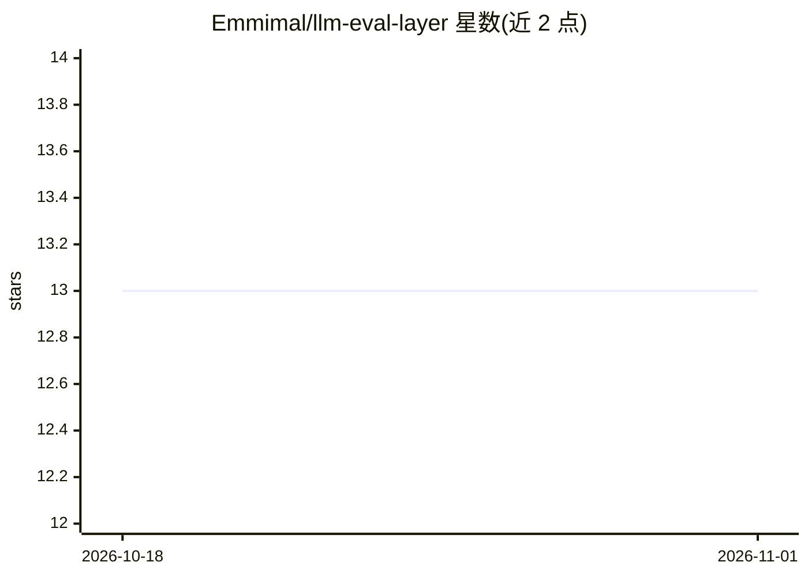

# Emmimal/llm-eval-layer

⭐ 13 · Python · MIT · 推送 2026-05-18 · [GitHub](https://github.com/Emmimal/llm-eval-layer) · 个人维护

**LLM 回答评测层：打分并输出 ACCEPT/REVIEW/REJECT 决策**

纯 Python 的 LLM 输出决策引擎：对 Query+Context+Response 计算归因度、具体性、相关性、上下文质量与一致性五个信号，经加权聚合与 8 道门控逻辑输出 ACCEPT/REVIEW/REJECT 决策、失败类型与建议动作，用于幻觉检测与 RAG 质量把关。核心功能仅需 Python 标准库加 PyYAML，sentence-transformers 为可选依赖（缺失时回退 TF-IDF），默认无 API 调用；LLM judge 仅在 0.45-0.65 不确定区间触发。附带回归套件，可在质量下降超过阈值时阻断部署。

## 筛选速览

| 维度 | 判定 | 备注 |
|---|---|---|
| AI 角色 | `ai-ecosystem` | LLM/agent 周边工具 |
| 许可风险 | `permissive` | MIT |
| 部署形态 | `library` | 以包/库形式分发 |
| 模型依赖 | — | README 未给出锁定关系 |
| 硬件要求 | `cpu-ok` | |
| 安装摩擦 | `low` | 无编译、无系统依赖或容器化 |
| 成熟度 | — | 结构信号不足 |

## 能力要点

- 五信号加权评分与 8 道门控决策，输出失败类型与建议动作
- 高具体性+低归因 判定为幻觉的区分机制
- 默认启发式模式零 API 成本，可选 TF-IDF 回退
- 回归套件存储基线，质量下降超阈值时阻断部署（CI/CD 质量门）

## 适用场景

- RAG 系统上线前检测并拦截幻觉回答
- prompt 或模型变更后做回归检查，防止质量回退
- 自动化流水线中在生成与交付之间加质量门

## 场景标签

`模型评测` · 领域:评测与运维

## 证据(README 行号)

> L10: This library handles what comes next — deciding whether that output should be served,
> L139: The most valuable component. Store baselines after validating your system, then run

## 星数曲线

2026-10-18 13 → 2026-11-01 13（+0）

---
*卡片 v1 · prompt 1.4 · 生成 2026-10-31 · 置信度 mid · 依据 README sha `432cc1bb36b5` · [字段定义](../../DATASET.md)*
