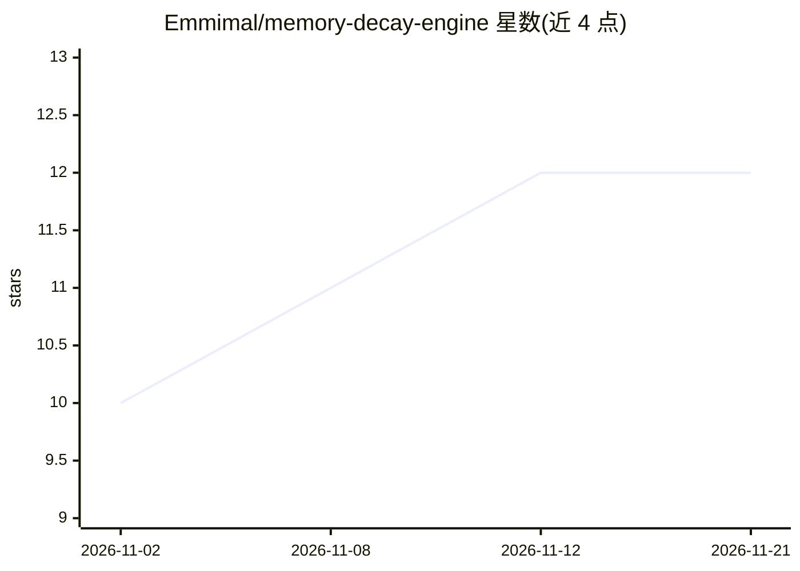

# Emmimal/memory-decay-engine

⭐ 12 · Python · MIT · 推送 2026-07-25 · [GitHub](https://github.com/Emmimal/memory-decay-engine) · [官网](https://towardsdatascience.com/author/emmimalp-alexander/) · 个人维护

**为 AI agent 上下文提供艾宾浩斯遗忘曲线记忆衰减引擎**

纯 Python、零第三方依赖的记忆管理库：针对长会话 agent 的上下文淘汰问题，用艾宾浩斯遗忘曲线对记忆项打保留分，每次召回增强稳定性、非线性延长淘汰期限；另提供固定窗口的 RecencyOnlyBaseline 作对照。库内含合成会话生成器、仿真驱动器、指标模块（FRR/ST/NR）、健全性检查、演示脚本与统计基准套件，所有脚本用 Python 标准库即可运行（测试于 Python 3.12）。README 明确列出已知限制：条目计数非真实 token 数、召回由仿真显式触发、默认参数只针对特定会话节奏调优、不处理矛盾记忆。

## 筛选速览

| 维度 | 判定 | 备注 |
|---|---|---|
| AI 角色 | `ai-ecosystem` | LLM/agent 周边工具 |
| 许可风险 | `permissive` | MIT |
| 部署形态 | `library` | 以包/库形式分发 |
| 模型依赖 | — | README 未给出锁定关系 |
| 硬件要求 | — | 无带数字的原话,不猜 |
| 安装摩擦 | `low` | 无编译、无系统依赖或容器化 |
| 成熟度 | — | 结构信号不足 |

## 能力要点

- 双可互换淘汰策略：usage-reinforced decay 与固定窗口基线，同一接口
- 基准套件含 50 种子、150 轮会话、15 组阈值×窗口敏感性扫描及失败案例
- 六个不变量健全性检查（sanity_check.py）先行校验基准数字
- 零依赖，仅 Python 标准库，requirements.txt 为空文件

## 适用场景

- 长程多轮 agent 会话中早期建立的关键事实长期不出现后仍需保留
- 跨多天任务的编码 agent 或长时间客服排障线程的记忆管理
- 作为对照基准研究上下文淘汰策略的差异

## 场景标签

`Agent 记忆` · 领域:Agent 开发

## 证据(README 行号)

> L3: A pure-Python, zero-dependency memory decay engine for AI agent context — implements Ebbinghaus forgetting-curve ret
> L7: Most long-running agent memory systems evict old context with a sliding window: if something hasn't been touched in 
> L25: |`memory_engine.py`|Two interchangeable eviction policies: `EbbinghausMemoryEngine` (usage-reinforced decay) and `R

## 星数曲线

2026-11-02 10 → 2026-11-21 12（+2）

---
*卡片 v1 · prompt 1.4 · 生成 2026-11-18 · 置信度 mid · 依据 README sha `f19fdc7fb50f` · [字段定义](../../DATASET.md)*
