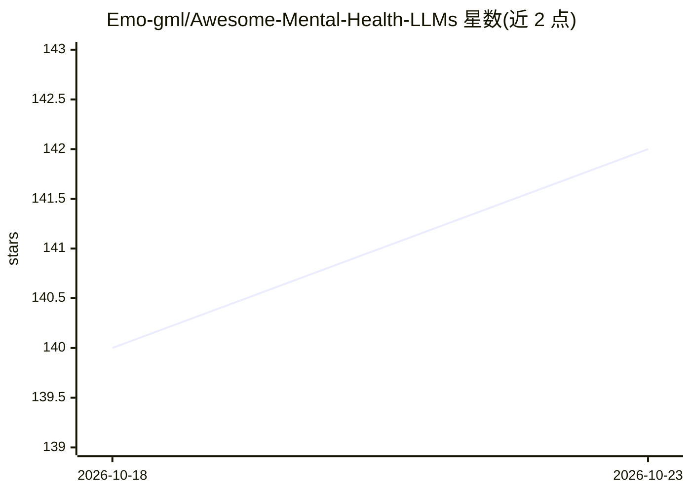

# Emo-gml/Awesome-Mental-Health-LLMs

⭐ 142 · MIT · 推送 2026-10-02 · [GitHub](https://github.com/Emo-gml/Awesome-Mental-Health-LLMs) · [官网](https://arxiv.org/abs/2609.25186) · 组织维护

**心理健康领域 LLM 论文与基准的策展综述清单**

配合综述论文《From Pattern Recognizers to Personalized Companions: A Survey of Large Language Models in Mental Health》（投稿 TAFFC，ArXiv:2609.25186）维护的 Awesome 清单：收录心理咨询、抑郁检测、情感支持对话、认知行为疗法、自杀风险识别等方向的 LLM 论文，多数条目附论文链接与代码/数据集链接；按模型适配方法、推理时策略、基准测评等章节组织，并持续以版本更新（v1.1-v1.9）追踪 ACL/EMNLP/ICLR 等会议新工作。面向心理健康 AI 方向的研究者，无安装或运行产物。

## 筛选速览

| 维度 | 判定 | 备注 |
|---|---|---|
| AI 角色 | `ai-knowledge` | 知识聚合/清单类 |
| 许可风险 | `permissive` | MIT |
| 部署形态 | `None` |  |
| 模型依赖 | — | README 未给出锁定关系 |
| 硬件要求 | — | 无带数字的原话,不猜 |
| 安装摩擦 | `low` | 无编译、无系统依赖或容器化 |
| 成熟度 | — | 结构信号不足 |

## 能力要点

- 对应一篇心理健康 LLM 综述论文的配套文献清单
- 按核心方法论、推理时策略、Benchmark 分类组织条目
- 持续版本化更新（v1.1-v1.9）追踪 2025-2026 新论文
- 多数条目附论文链接，部分附代码/数据集链接

## 适用场景

- 查找心理健康 LLM 方向的论文与代码
- 跟进心理咨询/抑郁检测/情感支持领域的最新基准
- 为综述写作收集文献线索

## 场景标签

`精选清单` `科研工具` · 领域:学习与行业

## 证据(README 行号)

> L23: ## 💙 From Pattern Recognizers to Personalized Companions: A Survey of Large Language Models in Mental Health
> L141: ## 1. Large Language Models for mental health

## 星数曲线

2026-10-18 140 → 2026-10-23 142（+2）

---
*卡片 v1 · prompt 1.4 · 生成 2026-10-23 · 置信度 high · 依据 README sha `c878dfdc5484` · [字段定义](../../DATASET.md)*
