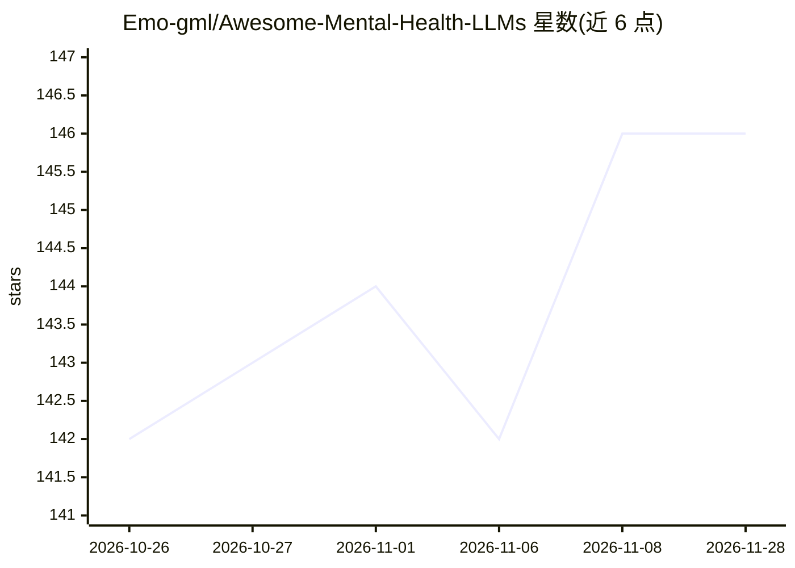

# Emo-gml/Awesome-Mental-Health-LLMs

⭐ 146 · MIT · 推送 2026-11-02 · [GitHub](https://github.com/Emo-gml/Awesome-Mental-Health-LLMs) · [官网](https://arxiv.org/abs/2609.25186) · 组织维护 · 中文 README

**面向科研者：心理健康领域 LLM 论文与基准的策展清单**

配套 TAFFC 综述论文的论文聚合仓库，按心理健康 LLM 主题收录论文并持续更新（含 v1.1 至 v1.10 多次增量）。条目按分类组织：模型适配方法、心理治疗策略、心理咨询评估、精神科诊断、患者模拟、安全与风险评估、多模态评估、基准测试等；每条目附论文链接，部分附代码与数据集链接。面向从事心理健康 AI 研究的人员，通过 issue 或邮箱接受补充建议。

## 筛选速览

| 维度 | 判定 | 备注 |
|---|---|---|
| AI 角色 | `ai-knowledge` | 知识聚合/清单类 |
| 许可风险 | `permissive` | MIT |
| 部署形态 | `None` |  |
| 模型依赖 | — | README 未给出锁定关系 |
| 硬件要求 | — | 无带数字的原话,不猜 |
| 安装摩擦 | `low` | 无编译、无系统依赖或容器化 |
| 成熟度 | — | 结构信号不足 |

## 能力要点

- 配套 TAFFC 综述论文，提供 ArXiv 链接与 BibTeX 引用
- 按治疗策略、诊断、患者模拟、评估基准等类别组织论文条目
- 持续更新机制，多批次增量收录论文
- 部分条目附带代码与数据集链接

## 适用场景

- 查找心理健康方向 LLM 相关论文与基准
- 为综述写作或课题调研梳理领域文献
- 寻找可复现的心理咨询/诊断模型代码与数据

## 场景标签

`科研工具` `精选清单` · 领域:学习与行业

## 证据(README 行号)

> L23: ## 💙 From Pattern Recognizers to Personalized Companions: A Survey of Large Language Models in Mental Health
> L228: ## 1. Large Language Models for mental health
> L225: - 4. Benchmark

## 星数曲线

2026-10-26 142 → 2026-11-28 146（+4）

---
*卡片 v1 · prompt 1.4 · 生成 2026-11-28 · 置信度 high · 依据 README sha `ad6014bbf70a` · [字段定义](../../DATASET.md)*
