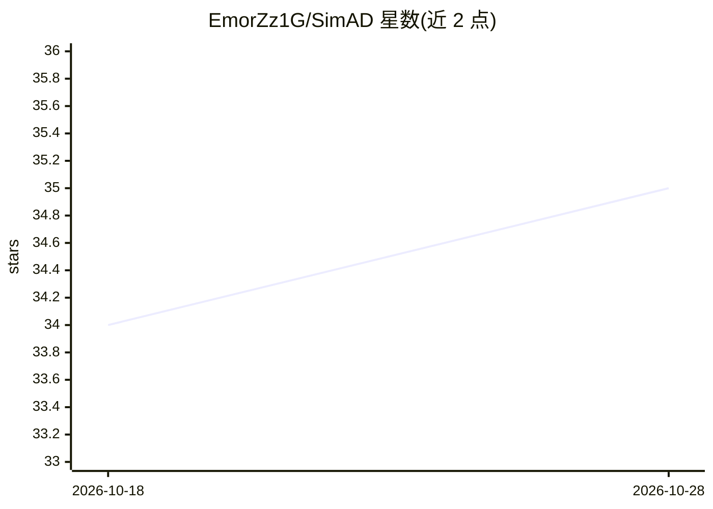

# EmorZz1G/SimAD

⭐ 35 · Python · Apache-2.0 · 推送 2026-01-19 · [GitHub](https://github.com/EmorZz1G/SimAD) · [官网](https://emorzz1g.github.io/SimAD/) · 个人维护

**TNNLS 2025 论文 SimAD 官方实现：时间序列异常检测**

论文《SimAD: A Simple Dissimilarity-based Approach for Time Series Anomaly Detection》（已被 TNNLS 2025 接收）的官方代码实现。方法面向时间序列异常检测：采用基于 patching 的特征提取器处理更长时序窗口，EmbedPatch 编码器整合正常模式，并设计 ContrastFusion 模块强化正常/异常分布差异；另提出 UAff 与 NAff 两个评估指标。提供预训练模型下载链接、数据集获取途径，通过 pip 安装 requirements.txt 后以 python main.py 脚本训练与推理，供科研复现与实验使用。

## 筛选速览

| 维度 | 判定 | 备注 |
|---|---|---|
| AI 角色 | `ai-native` | 本体是模型或模型工具 |
| 许可风险 | `permissive` | Apache-2.0 |
| 部署形态 | `library` | 以包/库形式分发 |
| 模型依赖 | — | README 未给出锁定关系 |
| 硬件要求 | — | 无带数字的原话,不猜 |
| 安装摩擦 | `low` | 无编译、无系统依赖或容器化 |
| 成熟度 | — | 结构信号不足 |

## 能力要点

- patching 特征提取 + EmbedPatch 编码器 + ContrastFusion 模块的检测方法
- 提出 UAff 与 NAff 两个增强评估指标
- 提供预训练模型与数据集下载途径
- 以 main.py 脚本进行训练与推理（GPU 可选）

## 适用场景

- 复现 SimAD 论文的时间序列异常检测实验
- 在七个公开时序数据集上训练/评估异常检测模型
- 使用 UAff/NAff 指标评估异常检测结果

## 场景标签

 · 领域:机器学习/时间序列异常检测

## 证据(README 行号)

> L3: This is the implementation of *SimAD: A Simple Dissimilarity-based Approach for Time Series Anomaly Detection*
> L13: To address these issues, we introduce a **Sim**ple dissimilarity-based approach for time series **A**nomaly **D**et
> L54: `python main.py --data_name MSL --win_size 25600 --lr 0.0001 --gpu -1 --resume 0 --index 1 --batch_size 32 --step 1

## 星数曲线

2026-10-18 34 → 2026-10-28 35（+1）

---
*卡片 v1 · prompt 1.4 · 生成 2026-10-25 · 置信度 mid · 依据 README sha `346d92ddc2d2` · [字段定义](../../DATASET.md)*
