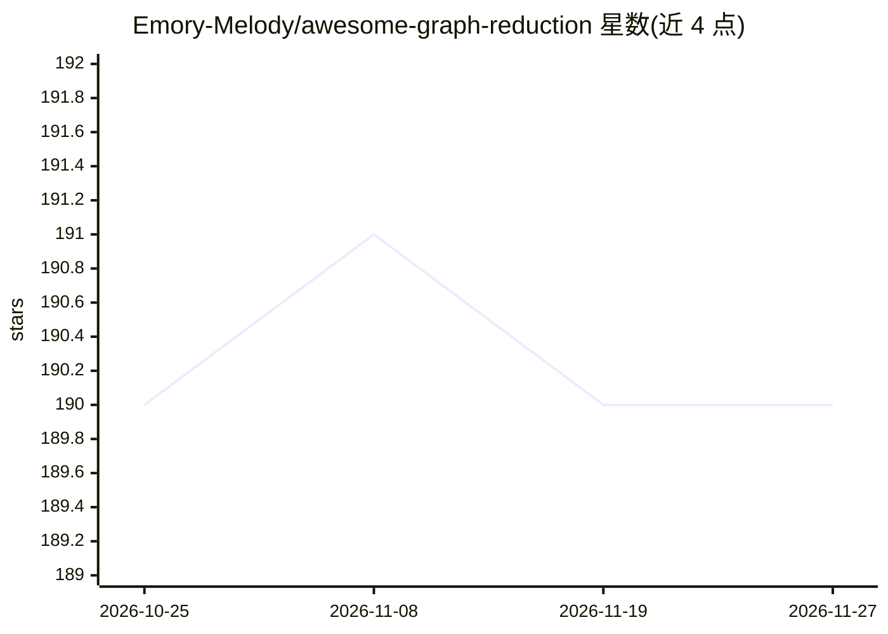

# Emory-Melody/awesome-graph-reduction

⭐ 190 · 推送 2026-11-19 · [GitHub](https://github.com/Emory-Melody/awesome-graph-reduction) · [官网](https://arxiv.org/abs/2402.03358) · 组织维护

**图缩减（浓缩/粗化/稀疏化）论文清单，服务 GNN 研究者**

IJCAI 2024 综述配套的论文清单，收录图缩减领域论文，按图浓缩/数据集蒸馏、图粗化、图稀疏化、图摘要等类别组织，多数条目附论文链接与代码仓库链接，接受 PR 补充新条目。同时推广作者自己的图缩减 PyTorch 库 GraphSlim。面向从事图神经网络与数据缩减研究的科研人员，本体为文献索引，不含可运行的自身代码或安装方式。

## 筛选速览

| 维度 | 判定 | 备注 |
|---|---|---|
| AI 角色 | `ai-knowledge` | 知识聚合/清单类 |
| 许可风险 | `none` | — |
| 部署形态 | `None` |  |
| 模型依赖 | — | README 未给出锁定关系 |
| 硬件要求 | — | 无带数字的原话,不猜 |
| 安装摩擦 | `low` | 无编译、无系统依赖或容器化 |
| 成熟度 | — | 结构信号不足 |

## 能力要点

- 按图浓缩、粗化、稀疏化、摘要等子方向分类组织论文条目
- 多数条目同时提供论文链接与代码仓库链接
- 配套 IJCAI 2024 综述并提供 BibTeX 引用条目
- 推荐作者团队的 PyTorch 图缩减库 GraphSlim

## 适用场景

- 调研图浓缩/图数据蒸馏方向的最新论文
- 为图缩减研究寻找带代码的基线方法
- 补充完善图缩减相关文献综述

## 场景标签

`科研工具` `精选清单` · 领域:学习与行业

## 证据(README 行号)

> L12: [IJCAI 2024] This is a curated list of papers about graph reduction including graph condensation, graph coarsening,
> L16: This list serves as a complement to the survey below.

## 星数曲线

2026-10-25 190 → 2026-11-27 190（+0）

---
*卡片 v1 · prompt 1.4 · 生成 2026-11-26 · 置信度 high · 依据 README sha `e9ffeadad547` · [字段定义](../../DATASET.md)*
