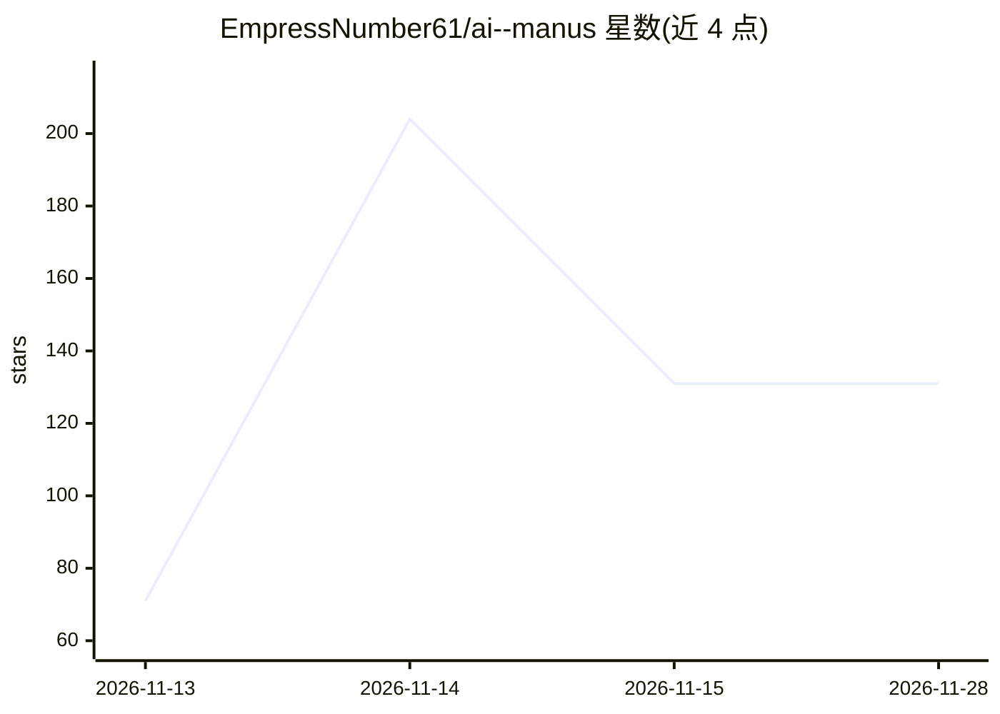

# EmpressNumber61/ai--manus

⭐ 131 · Apache-2.0 · 推送 2026-11-15 · [GitHub](https://github.com/EmpressNumber61/ai--manus) · 个人维护

**面向个人日常任务的自主 AI Agent：自动写代码并控制浏览器**

README 以宣传性文案描述一款自主 AI 代理：代用户编写并执行脚本、控制浏览器（打开页面、填表、采集信息）、执行多步骤任务并跨会话保持工作流一致。定位为面向家庭、学习与轻量办公的助手，面向非开发者用户。README 给出硬件兼容表（最低双核 CPU / 4 GB 内存）与使用步骤（准备、配置、测试等），但未提供具体安装命令、代码仓库结构、模型接入方式或 API 说明；文末列出大量搜索关键词，内容可验证性有限。

## 筛选速览

| 维度 | 判定 | 备注 |
|---|---|---|
| AI 角色 | `ai-native` | 本体是模型或模型工具 |
| 许可风险 | `permissive` | Apache-2.0 |
| 部署形态 | `None` |  |
| 模型依赖 | — | README 未给出锁定关系 |
| 硬件要求 | — | 无带数字的原话,不猜 |
| 安装摩擦 | `low` | 无编译、无系统依赖或容器化 |
| 成熟度 | — | 结构信号不足 |

## 能力要点

- 自主代码执行：代用户编写并运行脚本完成任务
- 浏览器控制：导航网站、填写表单、采集信息
- 代码与浏览器动作可在同一工作流中衔接
- 面向家庭、学习与轻量办公的小规模场景

## 适用场景

- 让学生整理研究资料并运行小脚本
- 代替手工在多个网页间收集信息并汇总
- 把重复性的日常小任务交给后台代理处理

## 场景标签

`AI 助手` `浏览器自动化` `编码 Agent` · 领域:效率与自动化

## 证据(README 行号)

> L10: - **Autonomous Code Execution:** Manus AI agent runs code on its own to complete tasks, so you can focus on decisio
> L18: Manus is an autonomous AI agent designed to run code and control a browser on your behalf. Instead of acting like a

## 星数曲线

2026-11-13 71 → 2026-11-28 131（+60）

---
*卡片 v1 · prompt 1.4 · 生成 2026-11-17 · 置信度 low · 依据 README sha `a3d88e202bf0` · [字段定义](../../DATASET.md)*
