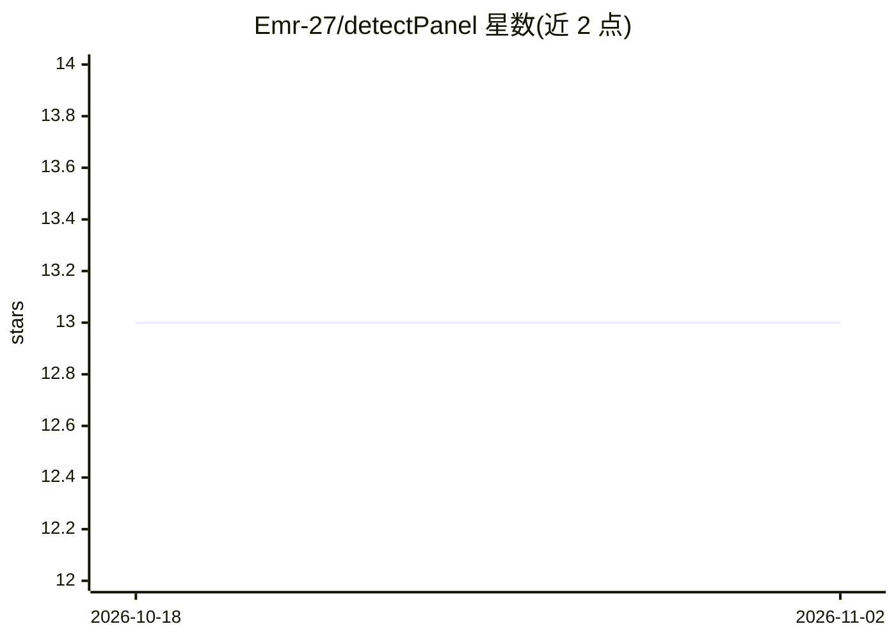

# Emr-27/detectPanel

⭐ 13 · R · NOASSERTION · 推送 2026-09-16 · [GitHub](https://github.com/Emr-27/detectPanel) · 个人维护

**R 包：从表达矩阵发现并验证小型生物标志物 panel**

面向二分类结局、高维少样本分子数据的 R 包，提供从特征过滤、小型 panel 搜索、嵌套交叉验证、logistic 拟合（含 L2 惩罚回退）到新样本预测、稳定性评估、可视化与结果导出的端到端流程。设计上在模型选择与验证中控制信息泄漏。README 明确提示：内部验证性能不能替代外部验证，所选 panel 应视为候选标志物模型而非临床验证证据。通过 GitHub（remotes）安装，CRAN 版本尚未发布。

## 筛选速览

| 维度 | 判定 | 备注 |
|---|---|---|
| AI 角色 | `ai-native` | 本体是模型或模型工具 |
| 许可风险 | `none` | NOASSERTION |
| 部署形态 | `None` |  |
| 模型依赖 | — | README 未给出锁定关系 |
| 硬件要求 | — | 无带数字的原话,不猜 |
| 安装摩擦 | `low` | 无编译、无系统依赖或容器化 |
| 成熟度 | — | 结构信号不足 |

## 能力要点

- 可检测性感知的特征过滤与正则排除
- 泄漏感知的嵌套交叉验证评估内部性能
- logistic 拟合含不稳定时的 L2 惩罚自动回退
- marker/ROC/热图/volcano/PCA-QC 绘图与结果导出

## 适用场景

- 从 miRNA/组学表达矩阵中筛选小型二分类标志物组合
- 用嵌套交叉验证评估候选 panel 的内部性能
- 将拟合模型应用于新样本输出预测概率

## 场景标签

 · 领域:生物信息学/组学

## 证据(README 行号)

> L3: `detectPanel` is an R package for discovering, validating, and applying small
> L6: It provides an end-to-end workflow for feature filtering, small-panel search,

## 星数曲线

2026-10-18 13 → 2026-11-02 13（+0）

---
*卡片 v1 · prompt 1.4 · 生成 2026-10-31 · 置信度 high · 依据 README sha `578c306fc09e` · [字段定义](../../DATASET.md)*
