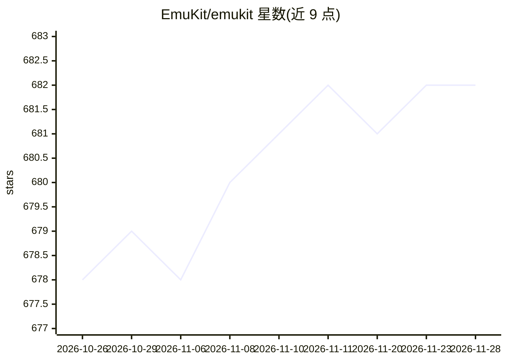

# EmuKit/emukit

⭐ 682 · Python · Apache-2.0 · 推送 2026-11-18 · [GitHub](https://github.com/EmuKit/emukit) · [官网](https://emukit.github.io/emukit/) · 组织维护

**不确定性决策 Python 工具箱：贝叶斯优化/多保真建模**

Emukit 是一个可扩展的 Python 工具包，用于在不确定性下辅助决策，适用于数据稀缺或获取困难的复杂系统场景。核心功能包括多保真代理建模、贝叶斯优化（用于物理实验与机器学习参数调优）、实验设计/主动学习、敏感性分析与贝叶斯求积。它对底层建模框架保持中立，可搭配 Python 生态中任意建模工具。通过 pip 安装，核心依赖为 GPy、NumPy、SciPy、matplotlib、emcee，另有 torch、scikit-learn 等可选扩展组；以 Apache 2.0 许可发布。

## 筛选速览

| 维度 | 判定 | 备注 |
|---|---|---|
| AI 角色 | `ai-enhanced` | 去掉 AI 部分产品仍成立 |
| 许可风险 | `permissive` | Apache-2.0 |
| 部署形态 | `library` | 以包/库形式分发 |
| 模型依赖 | — | README 未给出锁定关系 |
| 硬件要求 | — | 无带数字的原话,不猜 |
| 安装摩擦 | `low` | 无编译、无系统依赖或容器化 |
| 成熟度 | — | 结构信号不足 |

## 能力要点

- 多保真代理建模：整合不同保真度/成本的数据源
- 贝叶斯优化物理实验与机器学习参数
- 实验设计/主动学习与敏感性分析
- 对建模框架中立，可接入任意 Python 建模工具

## 适用场景

- 数据获取成本高的物理实验参数寻优
- 机器学习算法超参数调优
- 分析系统输入对输出的敏感性
- 昂贵函数的积分计算

## 场景标签

 · 领域:机器学习/科学计算工具库

## 证据(README 行号)

> L12: Emukit is a highly adaptable Python toolkit for enriching decision making under uncertainty. This is particularly p
> L17: * **Bayesian optimisation:** optimise physical experiments and tune parameters of machine learning algorithms;
> L22: Emukit is agnostic to the underlying modelling framework, which means you can use any tool of your choice in the Py

## 星数曲线

2026-10-26 678 → 2026-11-28 682（+4）

---
*卡片 v1 · prompt 1.4 · 生成 2026-11-24 · 置信度 high · 依据 README sha `6d496ecaa82b` · [字段定义](../../DATASET.md)*
