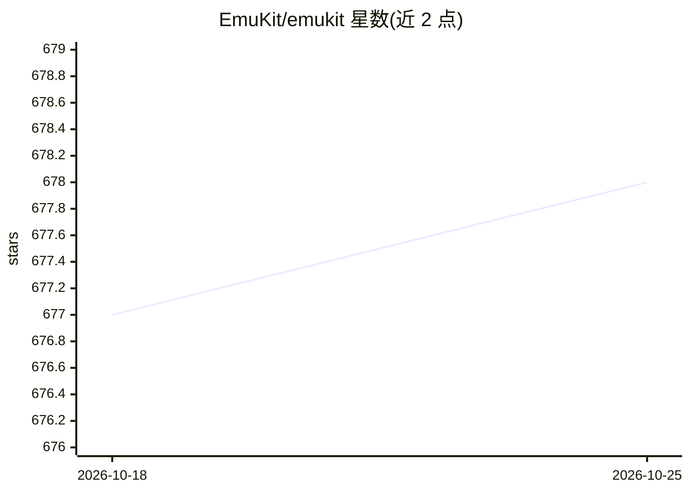

# EmuKit/emukit

⭐ 678 · Python · Apache-2.0 · 推送 2026-08-30 · [GitHub](https://github.com/EmuKit/emukit) · [官网](https://emukit.github.io/emukit/) · 组织维护

**不确定性下决策的 Python 工具箱：贝叶斯优化、实验设计等**

面向数据稀缺、获取成本高的复杂系统，提供多保真度代理建模、贝叶斯优化、实验设计/主动学习、敏感性分析与贝叶斯求积等方法。框架对底层建模工具不可知，可配合 Python 生态中任意模型库使用；通过 pip 安装，核心依赖为 NumPy/SciPy/matplotlib/emcee，可选 extras 集成 GPy、scikit-learn、贝叶斯神经网络（torch）。注意 GPy 暂不兼容 NumPy 2.0，部分采集函数依赖 GPy。以 Python 库形式提供，附教程 notebook。

## 筛选速览

| 维度 | 判定 | 备注 |
|---|---|---|
| AI 角色 | `ai-native` | 本体是模型或模型工具 |
| 许可风险 | `permissive` | Apache-2.0 |
| 部署形态 | `library` | 以包/库形式分发 |
| 模型依赖 | — | README 未给出锁定关系 |
| 硬件要求 | — | 无带数字的原话,不猜 |
| 安装摩擦 | `low` | 无编译、无系统依赖或容器化 |
| 成熟度 | — | 结构信号不足 |

## 能力要点

- 多保真度代理建模与贝叶斯优化
- 实验设计/主动学习与敏感性分析
- 贝叶斯求积：高效计算昂贵函数积分
- 对底层建模框架不可知，可搭配任意 Python 模型库

## 适用场景

- 优化物理实验或调优机器学习算法超参数
- 数据昂贵时设计信息量最大的实验
- 分析系统输入对输出的影响并量化不确定性

## 场景标签

 · 领域:机器学习/科学计算

## 证据(README 行号)

> L12: Emukit is a highly adaptable Python toolkit for enriching decision making under uncertainty. This is particularly p
> L16: * **Multi-fidelity emulation:** build surrogate models when data is obtained from multiple information sources that

## 星数曲线

2026-10-18 677 → 2026-10-25 678（+1）

---
*卡片 v1 · prompt 1.4 · 生成 2026-10-21 · 置信度 high · 依据 README sha `fb5e31c670a4` · [字段定义](../../DATASET.md)*
